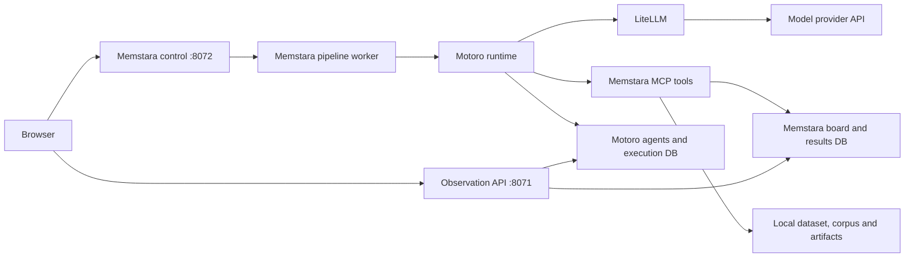

# Memstara developer guide

This guide describes the current working implementation: configuration, model routing,
execution controls, evidence storage, and debugging. Start with the installation steps
in [README.md](README.md#get-started) and the service setup in
[viewer/README.md](viewer/README.md). Run commands from the repository root with the
project's Python environment active. Examples use deployment placeholders, not usable
credentials or guaranteed model identifiers.

## Contents

- [Architecture and ownership](#architecture-and-ownership)
- [Environment and configuration precedence](#environment-and-configuration-precedence)
- [Model profiles and their limits](#model-profiles-and-their-limits)
- [Change a saved pipeline through the API](#change-a-saved-pipeline-through-the-api)
- [Configure a single combination](#configure-a-single-combination)
- [Start, pause, resume, and end](#start-pause-resume-and-end)
- [Restart after a change](#restart-after-a-change)
- [Agent contracts and skills](#agent-contracts-and-skills)
- [Read and verify an execution](#read-and-verify-an-execution)
- [Troubleshooting](#troubleshooting)
- [Development checks and source map](#development-checks-and-source-map)

## Architecture and ownership



Memstara owns research policy, skills, stage routing, data/ML tools, and the workspace.
Motoro is an imported runtime library; it provisions agents and executes their calls.
LiteLLM is used inside Motoro for provider calls and usage accounting. An API call made
directly to a provider proves connectivity only; it does not verify the pipeline path.

`PipelineLLMService` is Memstara's runtime adapter. It supplies request policies and
installs a process-local pricing compatibility adapter. This does not edit Motoro's
source or its pricing database. Unknown deployment prices remain unavailable; a zero
cost field without supported pricing must not be interpreted as free execution.

The web container normally serves port 8070. `/control/` is proxied to the host control
service, and `/api/` to the observation API. The control service can launch processes;
it is not a read-only service. Database connection setup and local access boundaries
are described in the viewer README.

## Environment and configuration precedence

[env.py](src/memstara/env.py) loads the selected project `.env` before runtime
initialization. Managed shell values and sibling files are not fallback sources.
Explicit environment injection is a separate mode, described below. Editing a
file does not replace settings already loaded into a running process.

| Setting | Purpose |
|---|---|
| `MEMSTARA_LLM_PROVIDER`, `MEMSTARA_LLM_MODEL` | Deployment default model selection |
| `MEMSTARA_LLM_API_BASE` | Endpoint for the deployment default provider |
| `OPENAI_API_KEY` | OpenAI-compatible provider credential |
| `ANTHROPIC_FOUNDRY_API_KEY`, `ANTHROPIC_FOUNDRY_RESOURCE` | Claude-on-Foundry credential/resource; an explicit profile `api_base` can supply the endpoint |
| `ANTHROPIC_API_KEY` | Native Anthropic credential |
| `MOTORO_DATABASE_URL` | Motoro agents and execution records |
| `MEMSTARA_DATABASE_URL` | Memstara tasks and results |
| `MEMSTARA_DATASET_PATH` | Input cohort CSV |
| `MEMSTARA_OUTCOME_COLUMN` | Target excluded from predictor discovery; keep consistent with `y_column` |
| `AGENTIC_OKF_BUNDLE_DIR` | Knowledge corpus directory |
| `MEMSTARA_OUTPUT_DIR` | Tool-generated data and model artifact root |
| `MEMSTARA_EXPLANATION_SOURCES` | Optional explicit expert-source binding JSON |

Use [.env.example](.env.example) for product settings. Keep credentials in the local
runtime environment; never put them in `stage_models`, a request JSON file, or a prompt.
`ANTHROPIC_FOUNDRY_BASE_URL` alone is not a substitute for the runtime's resource/profile
configuration: inspect the explicit profile and resolver rather than assuming that
any environment variable with a similar name is consumed.

The selected project `.env` is the operational source. No sibling `.env`, shell
fallback or automatic model JSON loading is used. Explicit
`MEMSTARA_CONFIG_MODE=environment` supports CI and supervised processes. File mode
resolves paths relative to the selected file, independently of the launch directory.
`MEMSTARA_ENV_FILE` can select a different project file. Restart after edits.

`MEMSTARA_LLM_*` defines the default profile; `MEMSTARA_NON_EXPLANATION_*` and
`MEMSTARA_EXPLANATION_*` override the corresponding role group. See `.env.example`
for supported fields. `python -m memstara.local_setup check` performs static checks,
not network, database or inference validation.

Design creation and saving do not require model connectivity. Execution does:
new launches resolve project settings and freeze them. A legacy nonempty
`stage_models` different from project defaults must be reviewed and explicitly
cleared through the configuration API before a new launch. Historical recovery
continues using its frozen assignment. Configure model fields directly in `.env`.
Never place credentials in profiles or research definitions.

Storage initialization and local provisioning validate the Memstara/Motoro database
separation before launching migrations or Docker. New web executions also apply
static operational validation before creating a run directory or worker. Registered
research inputs supersede unused legacy CSV/OKF defaults during that check. These
checks do not prove provider connectivity; actual execution remains the inference
check. Design saving does not require these execution checks.

`outputs/runs/pipeline_workspace.json` stores editable pipeline definitions. The
control service also keeps them in memory: update them through its API. Per-execution
`config.json`, `prompts.json`, and `resume_arguments.json` are historical evidence,
not files to edit to change the next experiment. The run-directory root is defined
separately from `MEMSTARA_OUTPUT_DIR` in [paths.py](src/memstara/paths.py).

## Model profiles and their limits

The current implementation accepts exactly two profile keys, `non_explanation_agents` and `explanation_agent`.
These model-independent names identify two stage groups; deployment names can belong to other model families. They are not five independently configurable stage slots.

| Profile | Roles |
|---|---|
| `non_explanation_agents` | Question generation, Hypothesis, Data, ML, Interpretation |
| `explanation_agent` | Explanation, internally called `report` |

Legacy configurations with exactly `qwen`/`sonnet` or `analysis`/`explanation` are accepted and normalized
to `non_explanation_agents` and `explanation_agent`. Mixed or duplicate old/new keys are rejected.
Historical artifacts are not rewritten. Stage routing and model identities do not change.

Conceptual profile structure (replace every example endpoint/deployment):

```json
{
  "non_explanation_agents": {
    "provider": "openai",
    "model": "qwen-your-deployment",
    "api_base": "https://your-qwen-endpoint.example.com/v1",
    "max_tokens": 4096
  },
  "explanation_agent": {
    "provider": "azure_foundry",
    "model": "claude-sonnet-your-deployment",
    "api_base": "https://your-foundry-resource.example.com",
    "max_tokens": 4096
  }
}
```

`model` is the actual deployment identifier. A model catalog entry is not proof that
that identifier is deployed or supports the requested API. For Claude on Foundry,
use the `azure_foundry` provider and the resource base URL; Motoro/LiteLLM select the
Anthropic Messages route. Do not send that model to an OpenAI Chat Completions URL
merely because the resource also exposes an OpenAI-compatible endpoint.

Allowed profile fields are `provider`, `model`, `api_base`, `temperature`,
`max_tokens`, and `effort`. Endpoints must use HTTPS without embedded credentials,
query parameters, or fragments. The validator checks nonempty deployment names and basic ranges;
it does not prove a deployment supports every generation parameter. Omit unsupported
sampling controls and verify the actual provider request.

The Qwen request adapter can raise the outgoing token limit to its policy minimum and
apply reasoning settings. A profile's `max_tokens` is therefore not necessarily the
final request limit. See [runtime.py](src/memstara/pipeline/runtime.py),
[llm.py](src/memstara/pipeline/llm.py), and recorded provider diagnostics.

There is currently no dedicated per-stage model editor in the browser. Switching
Explanation to another supported model only requires editing the `explanation_agent` profile. Assigning a different model to ML alone requires changing
[stage_models.py](src/memstara/stage_models.py), its validation and routing tests, and
any configuration consumers. Renaming a profile key or editing `.env` alone is not
sufficient. Do not silently substitute a model when a deployment fails.

## Change a saved pipeline through the API

The following Python fragments use the standard library. Run them in the same Python
session, or combine them into a local script. Configuration updates do not start a run.

First read a summary without dumping endpoint or credential configuration:

```python
import copy
import json
from urllib.request import Request, urlopen

BASE = "http://127.0.0.1:8072"

def request(path, body=None):
    payload = None if body is None else json.dumps(body).encode("utf-8")
    req = Request(BASE + path, data=payload,
                  headers={"Content-Type": "application/json"})
    with urlopen(req, timeout=60) as response:
        return json.load(response)

pipelines = request("/control/pipelines")["pipelines"]
for item in pipelines:
    print(item["id"], item["name"], "running:", bool(item.get("running")))
```

Select the intended pipeline and change only the desired model fields. This example
requires an existing two-profile definition. To introduce profiles to a legacy
pipeline, assign the complete validated structure shown above instead.

```python
pipeline_id = "REPLACE_WITH_PIPELINE_ID"
item = next(p for p in pipelines if p["id"] == pipeline_id)
if item.get("running"):
    raise RuntimeError("End the execution before changing its configuration")

configuration = copy.deepcopy(item["configuration"])
profiles = configuration["stage_models"]
if set(profiles) != {"qwen", "sonnet"}:
    raise ValueError("This example requires existing Qwen/Sonnet profiles")

profiles["non_explanation_agents"]["model"] = "qwen-your-new-deployment"
profiles["explanation_agent"]["model"] = "claude-sonnet-your-new-deployment"
# Preserve provider/api_base only when the new deployment uses the same connection.
# Otherwise change those fields together and configure the matching credential.
saved = request("/control/pipelines", {
    "action": "update", "id": pipeline_id, "configuration": configuration
})
assert saved["configuration"]["stage_models"] == profiles
print("Saved configuration for", saved["id"])
```

`configuration` is a replacement object, not a recursive patch. Preserve all existing
fields unless deliberately changing them. The service rejects changes to a live
pipeline, including one with a paused process. Do not directly edit the workspace
JSON while the service is running.

## Configure a single combination

Skill identifiers come from `GET /control/playbooks`; knowledge filters come from
`GET /control/skills`. Use identifiers actually available on the deployment.
Current specialist skills require their external source files to be installed.

To set the first specialist route on the configuration obtained above:

```python
configuration.update({
    "combination_skills": {
        "hypothesis": ["addiction-psychiatric"],
        "data": ["data_training_heavy"],
        "ml": ["ml_logistic_regression"],
        "interpreter": ["shared-anil-shap"],
        "report": ["shared-anil-addiction"]
    },
    "combination_repetitions": 1,
    "combination_random_start": False,
    "combination_max_loops": 1,
    "baseline_columns": [],
    "waves": 1,
    "continuous": False
})
# Keep the existing, verified y_column and evaluation settings.
saved = request("/control/pipelines", {
    "action": "update", "id": pipeline_id, "configuration": configuration
})
```

An alternative is `action: "add"` with `name` and the complete `configuration`, which
creates a separate definition and returns its `id`. The workspace has no fixed limit on saved pipeline definitions. Adding or updating a definition does not execute it.

All Combinations schedules the Cartesian product of selected skills. Normally total
Loops equal the product of skill counts times repetitions. When `combination_max_loops`
is set, it supplies the execution budget instead; the ordered/cyclic schedule may
cover only part of the combinations or repeat them. Check the saved combination plan
rather than assuming a particular total such as 64. A Loop can contain many model
calls. Random Start randomizes the schedule's starting position; it is different from
the `random_features` Hypothesis skill.

## Start, pause, resume, and end

Starting spends model and compute resources. Run only the start command matching the
intended operation. These examples use `request` and `pipeline_id` defined above.

| Operation | Request |
|---|---|
| First execution of a definition | `POST /control/runs`, body `{"pipeline_id": "..."}` |
| New execution after a previous one | Same route, with `execution_mode: "fresh"` and `expected_run_tag` |
| Request pause | `POST /control/runs/{run_tag}/pause`, body `{}` |
| Resume | `POST /control/runs/{run_tag}/resume`, body `{}` |
| End the live process | `POST /control/runs/{run_tag}/end`, body `{}` |
| Read workspace execution state | `GET /control/pipelines` |
| Read execution records | `GET /control/runs` |

For a definition that has never run:

```python
started = request("/control/runs", {"pipeline_id": pipeline_id})
run_tag = started["run_tag"]
print(run_tag, started["run_dir"])
```

For an existing definition, refresh its execution history and supply the actual last
run tag. A stale tag is rejected rather than launching against changed history:

```python
started = request("/control/runs", {
    "pipeline_id": pipeline_id,
    "execution_mode": "fresh",
    "expected_run_tag": "REPLACE_WITH_LATEST_RUN_TAG"
})
run_tag = started["run_tag"]
print(run_tag, started["run_dir"])
```

Pause is cooperative: an in-flight call may still be finishing. A pause acknowledgement
is not proof of zero active work. Use execution state and `active_calls` to distinguish
requested pause from a settled pause. Resume continues the same run when safe; it does
not reload new Python code into a live worker. Checkpoint recovery rejects changed code,
failed executions, and interrupted operations whose effects cannot be safely replayed.
Preserve the old evidence and use a fresh execution when recovery is blocked.
Recovery also rejects incomplete or malformed checkpoint evidence: missing code
identity, invalid counters/call states, or an operation marked complete without a
saved result. A saved JSON `null` result is valid; a missing result field is not.
Legacy checkpoints without code identity cannot bypass this check. Preserve them
for inspection; do not fill in a new hash or completion field to force a resume.

Checkpoint JSON writes use a unique, exclusively created temporary file beside
the destination, flush it to disk, then atomically replace the destination and sync
its directory. Concurrent saves cannot reuse one another's temporary file. A failure
before replacement preserves the old destination; a directory-sync failure after
replacement is still reported because durability has not been confirmed. Abrupt
process termination can leave a temporary file, which later saves do not reuse.
This protects complete-file publication, not ordering or merging of concurrent
updates, cross-database transactions, or a tested guarantee against power loss.

For CLI operation, `python -m memstara.pipeline.board --help` lists the supported
options. `--stage-models` takes a JSON object with the same two profiles. It does not
read a JSON filename automatically. CLI flags are not a replacement for the control
workspace's stored definition; choose one launch path and record it.

## Preserve contributed skill originals

Treat supplied skill and reference files, including archived versions, as immutable.
Adapt behavior in Memstara-owned adapters or separate instructions. A runtime hash
computed after reading a file does not prove that the original was preserved.

Use a dedicated protected directory for each contributor's supplied files. Include
archived files in that directory; the verifier recursively covers all regular files
without filtering by extension. List every applicable directory explicitly. Roots
must not overlap, and symlinks, missing roots and unreadable directories are errors.
This check protects the listed inventory, not unlisted folders or all repository
history. It does not prevent a filesystem write or replace source-access controls.

Create a baseline once, outside those directories:

```sh
mkdir -p outputs/skill-integrity
python -m memstara.skill_integrity snapshot \
  --root contributor_a=/path/to/contributor-a-originals \
  --root contributor_b=/path/to/contributor-b-originals \
  --manifest outputs/skill-integrity/baseline-v1.json
```

The command refuses to overwrite an existing manifest. Save its returned
`manifest_sha256` in an independent trusted review record. Do not calculate a new
digest from the current manifest every time you verify: that would hide replacement
of the baseline itself. The manifest contains aliases, relative filenames, byte
sizes and hashes, not source contents or absolute source paths. Keep real contributor
inventories local unless redistribution of that metadata is approved.

Before and after a workflow or release check, use the same manifest and retained
digest:

```sh
python -m memstara.skill_integrity verify \
  --root contributor_a=/path/to/contributor-a-originals \
  --root contributor_b=/path/to/contributor-b-originals \
  --manifest outputs/skill-integrity/baseline-v1.json \
  --manifest-sha256 REPLACE_WITH_THE_INDEPENDENTLY_RETAINED_SHA256
```

Exit status is **0** for unchanged files, **1** for changed/added/missing files,
and **2** for invalid input or an unavailable/unverifiable inventory. A baseline
digest mismatch is an error. Verification does not rewrite any source or baseline.
Run this command as a required pre/post step in environments holding the originals;
public CI tests the verifier with synthetic fixtures, not absent private originals.
The pipeline does not automatically invoke this deployment-specific command.

An observed snapshot only establishes **unchanged since that snapshot**. Authenticity
of the original requires comparison with a trusted delivery/archive or contributor
confirmation; neither a self-generated hash nor a passing check proves it. Record
that provenance and reviewer separately. If a contributor supplies a new version,
retain the old file and manifest, store the new delivery under a new version identity,
review the differences, and create a new manifest and separately retained digest.
Never regenerate the old baseline merely to make a failure pass.

## Motoro release compatibility

This checkout uses Motoro `v0.10.0`. Use Python 3.12 or 3.13;
Memstara constrains Python to `<3.14` because its pinned viewer-test FastAPI and
MCP 1.29+ have conflicting Starlette requirements on later Python versions.
The MCP SDK requirement is `>=1.29.0,<2.0.0`.

A Git checkout update alone does not refresh installed version metadata. After
selecting the intended Motoro tag, reinstall its editable package in the same
Python environment that launches Memstara. Compare both the source tag and
`importlib.metadata.version("motoro")`. Back up the runtime database and apply
Motoro's official migration chain before starting a worker on the new release.
For v0.10.0 the schema head remains `6a4d9f2c7e10`; the v0.9.0-to-v0.10.0 diff
contains no migration changes. Restart existing host processes after
the update; already-imported modules do not change when a checkout changes.

Verified on 2026-10-09: editable install reports Motoro `0.10.0`; 80 focused
Memstara compatibility tests and 44 upstream model-capability tests passed.
`uv pip check` reported all 149 installed packages compatible. These are offline
checks, not live inference or full pipeline acceptance. The control service was
restarted after confirming no active execution, and its research-input API responded.
Motoro v0.10.0 changes sampling defaults for unknown models and supports explicit
resolved capabilities; validate provider-specific settings before a live run.

## Restart after a change

| Change | Required action |
|---|---|
| Saved profile/skill selection via API | End the existing execution, save, then start a fresh execution; no control restart for this alone |
| `.env`, API key, endpoint environment | Restart control from an environment without stale exported values, then launch a new worker |
| Pipeline Python implementation | Run focused checks and start a new worker; restart control too if its imported code changed |
| Observation API code | Restart/rebuild API, or use its development reload mode |
| Frontend code | Vite updates development views; Docker serving requires a web rebuild |
| Prompt or skill text | Start a new execution and verify the frozen prompt/source hash; preserve old snapshots |

For host control, stop its terminal process after managing active pipeline workers,
then start `python -m memstara.control` again. Restarting the web container alone
neither reloads the host control environment nor updates a running pipeline worker.
Starting a second control process on the same port is not a restart.

```bash
# Rebuild only the viewer services that changed.
docker compose -f viewer/docker-compose.yml up -d --build --no-deps api web
```

A successful server health check does not prove that a model deployment can respond.
Verify a small synthetic call through Memstara's `PipelineLLMService` and Motoro, then
validate the requested route end to end. A model-list response is insufficient.

## Agent contracts and skills

| Stage | Inputs and responsibilities | Evidence to inspect |
|---|---|---|
| Question/Hypothesis | Knowledge sources, question history and eligible feature context; choose a research question and predictors | Question lineage, knowledge reads, selection provenance, model/tool traces |
| Data | Exact hypothesis predictors, target and allocation skill; server validates extraction and executes the split | Extracted data identity, allocation proposal, row indices and class counts |
| ML | Frozen data allocation; LLM proposes settings for the one selected LR or XGBoost model within resource/parameter constraints | Accepted selected-model plan, its result, split and prediction files |
| Interpretation | Selected SHAP or LIME skill, selected model's measured evidence | Single-model handoff, XAI artifacts, input/output receipts |
| Explanation | Interpretation outputs and scoped knowledge retrieval | Retrieval receipts, supplied document identities, actual model record and report |

All Combinations freezes a 4–20 original-predictor policy. `random_features` selects
within the same bounds using recorded sampling state; target columns are excluded.
For new combination runs, Guided and Random share a complete-predictor candidate
pool compatible with either selected model. Missing-value columns are excluded before
question generation; no patient rows or values are changed or imputed. Eligibility
checks use input completeness, not outcome associations or model scores. The frozen
context records excluded columns/counts, the eligibility policy and the candidate
pool hash. Fewer than four complete predictors blocks launch before paid model calls.
The model-specific ML validator remains enabled as a final integrity check.
This changes new-run candidate eligibility; historical samples and results are not
rewritten. Standalone XGBoost retains its native missing-value support.
An extracted CSV includes the target for learning, but that target must never be in
the fitted predictor list. Use recorded model inputs to verify this distinction.

`data_training_heavy` allows an evaluation fraction of 0.1–0.3 of the exploration
population. `data_balanced_stratified` fixes it at 0.5. Both require stratification.
Here "balanced" means equal train/evaluation sizes, not class oversampling. A separate
validation reserve is removed before this allocation. Counts, indices and seeds are
saved for the selected model's partition.

These are the two built-in selectable Data skills. Exact feature extraction,
target preservation, missing-column reporting and the saved handoff to ML are
common instructions in `prompts/board/data.md`, independent of the allocation
skill. `data_exact_features` is retired from new skill menus; its unchanged text
is kept under `playbooks/legacy/` solely for loading old configurations and
reproducing historical prompts. Selecting research inputs preserves the selected
Data strategy, or defaults to `data_training_heavy` when none is selected or the
retired extraction choice was inherited. Existing saved runs are not migrated.

`ml_logistic_regression` (Logistic Regression) and `ml_xgboost` (XGBoost) are the
two built-in selectable ML skills. The selection fixes the only model before fitting;
the tool rejects an agent proposal that changes it or adds another model. Only that
model is trained and saved for SHAP/LIME. Selecting either skill enables this policy
even outside All Combinations.

Training safety, evaluation and structured-result reporting are common instructions
in `prompts/board/_ml_common.md`. Clinical presentation belongs downstream. The
six former ML playbooks remain under `playbooks/legacy/` for saved configurations
and are not offered in new menus. New creation drafts translate old choices into
LR or XGBoost; historical run settings and frozen prompts are not rewritten. The LLM does not have unrestricted control over compute:
server-owned parameter ranges, data splits, fit budgets, CPU/thread and memory limits
still apply. See [ml_configuration.py](src/memstara/ml_configuration.py) and
[paired_ml.py](src/memstara/paired_ml.py), which retains its historical filename but
now supervises only the selected model for each pipeline combination.

Matched experiments with `controlled_comparison` use a server-owned, precommitted
ML plan instead of asking the LLM to reproduce it. `get_ml_configuration` returns
`plan_source: server_frozen`; the agent should omit `ml_plan` from `train_and_score`.
The server validates and applies the frozen plan, including its rationale. A supplied
proposal cannot change it. The evaluation artifact records `ml_plan_resolution`,
including the submitted proposal, whether it was ignored, and the effective plan.
Ordinary configurable runs still require a complete LLM proposal and rationale.

The current shared specialist catalog uses exact root filenames:
`SHAP-Interpretation.md`, `LIME-Interpretation.md`, `Addiction-Expert-Explanation.md`,
and `HIV-Expert-Explanation.md`. Resolution is defined by
[catalog.py](src/memstara/control/catalog.py); archived files are not fallback sources.
Deployments need authorized current copies, and runs freeze their contents/hashes.
Each Interpretation specialist receives only the selected model; choosing SHAP for a
single route does not also execute LIME. Inspect the recorded explanation sample size: bounded XAI
samples are not automatically summaries of the entire evaluation cohort.

Without an explicit `MEMSTARA_EXPLANATION_SOURCES_JSON` binding, current expert Explanation
uses provisional metadata-keyword scopes over the configured OKF corpus. Scopes may
overlap, and the policy records that confirmation is still required. These are not
separate approved clinical databases. Explicit SQLite/PostgreSQL bindings use
the inline `.env` schema in [deployment settings](deployment/README.md#optional-inline-settings).
Do not invent corpus taxonomy filters for a clinical domain: query available filters.
Missing scoped evidence fails explicitly instead of falling back to unrelated sources.

## Read and verify an execution

Use the `run_dir` returned by start; do not select a folder solely by its modification
time. Store execution identifiers alongside comparisons so another route's results
cannot be mistaken for this one. Paths below are relative to that run directory unless
stated otherwise.

| Artifact | What it establishes |
|---|---|
| `config.json`, `prompts.json` | Frozen policies, profiles, skills, prompt contents and identifiers |
| `loop_1_flavors.json` and subsequent Loop files | The scheduled condition for each Loop |
| `execution.json`, `calls_checkpoint.json` | Agent run IDs, stage status and timing |
| `trace/*.txt`, `trace/*.llm.txt` | Saved stage/tool traces and captured model request evidence |
| `provider_diagnostics.jsonl` | Response finish reasons, token limits, tool-call argument shape |
| `request_events.jsonl` | Correlated application request starts, terminal outcomes, attempts, configured deadlines and elapsed time |
| `model_io/<request-id>.*.json` | Private, redacted service input/output or safe failure packets, linked by hashes |
| `trace/<agent-run-id>.steps.json` | Exported public Motoro run/step records, including full tool arguments/results |
| `model_retries.jsonl` | Retry events, when retries occur |
| `feature_reproduction/` | Local input/corpus archive, selection policy and accepted extraction receipts |
| `board.json` | Final task/result snapshot, including model evidence references |
| Referenced reproducibility bundles | Fitted models, split indices, probabilities, labels, effective settings and manifests |
| Referenced Interpretation receipts | Exact handoff and saved interpretation output |
| `explanation_io/` | Scoped retrieval/input/output/model records and per-Loop report receipts |
| `report.md`, `report_status.json` | Final report and its acceptance status |
| `pipeline_status.json`, `iteration_outcomes.json` | Overall/Loop outcomes, missing trials and unfinished tasks |
| `pipeline_failure.json`, `failure_frames.json` | Failure category and relevant frames when present |
| `checkpoint.json`, `execution_control.json` | Recovery bookkeeping and active-call state |

Some files exist only after the corresponding stage, or only on failure. Model/XAI
bundles and Interpretation receipts can live outside `run_dir` under the configured
artifact root; follow their recorded paths. Copying only `report.md` or the run folder
does not necessarily preserve a complete replay bundle. These artifacts can contain
sensitive data and prompts; they are not public documentation examples.

For the first debugging pass, inspect a running or finished execution without a
database connection or another paid model call:

```bash
python -m memstara.trace.diagnose --from outputs/runs/<execution>
python -m memstara.trace.diagnose --from outputs/runs/<execution> --json
```

The summary joins each application model attempt's start and terminal event by
`request_id`, with its agent `run_id`, stage, Loop, model, elapsed time, safe error
types and available provider correlation IDs. The same request ID is added to usage
receipts, provider response diagnostics and retry records. Each retry gets a new ID;
the agent run ID remains stable. Transport retries do not replay committed tools.
Start records are appended before awaiting the service, so a slow response can be
investigated before it finishes. Duration includes service/tool processing in that
method; it is not a measurement of model inference alone. The recorded timeout policy
is application configuration, not proof of the provider's internal deadline.

`unresolved` means no terminal record was observed. It can mean a pending request,
process termination or lost evidence; it does not by itself mean the process is alive.
Malformed/truncated files, unmatched starts/ends and missing usage receipts are
reported as incomplete request evidence. Historical executions without the new journal
remain readable via stage/retry records, with request evidence explicitly unavailable.
A journal write failure emits a warning rather than masking the provider result or
original failure. Consult `console.log` for those warnings even when other records
appear complete. The completeness flag certifies these request records only, not all
tool payloads, database rows or the entire pipeline audit.

The diagnosis also exposes `service_io_evidence_complete` and
`stage_evidence_complete` separately. Service input files are atomically saved and
flushed before invoking the LLM service, independent of LiteLLM console interception.
Outputs are saved immediately after return; errors retain a safe failure packet.
That packet does not establish a model output: a failed service with no returned
response remains incomplete output coverage, even if a later retry succeeds.
They contain normalized application-service messages, tool schemas/options and returned
objects, with credential fields and configured secret values redacted. They are not
the exact wire request after provider adaptation. Cancellation/pending attempts have
an unobserved response and cannot certify complete input/output coverage. File hashes,
size and execution identity are checked without printing payload contents. Missing,
modified, mismatched or unsupported payloads remain explicitly incomplete.

After each board agent, public Motoro run/step records are exported to a private JSON
file. This includes mapped input/output, model and tool records; ORM relationships are
not loaded. The stage reference is saved in the execution manifest. Missing or
unfinished steps cannot certify stage coverage. Proposal execution instead reads its
existing `proposal_io/` stage input/output files, since no Motoro agent run exists there.
Evidence file existence or a request-level completeness flag alone does not establish
that every expected agent/Loop ran. Combine these checks with pipeline outcomes,
scheduled conditions and registry reconciliation. Original supplied skills are unchanged.

For an explicit paid multi-Loop audit, using both profiles set to Haiku 5.5:

```bash
python -m pytest tests/live/test_haiku_pipeline.py --run-live --live-loops 2 --live-audit-io -k 'okf-dataset' -x -s
```

This selects one corpus+CSV case for two Loops; it does not launch the 64-condition
study. The default live test remains one Loop per selected case. Historical evidence
without these exports must not be passed as new input/output audit acceptance.

To validate an installed distribution, install the candidate wheel and locked runtime
dependencies in a separate virtual environment, then add
`--live-installed-python /path/to/environment/bin/python` to the live command. Use
`--live-loops 1` for a single bounded run. The test controller still reads the local
configuration and synthetic example, but starts the pipeline using the installed
interpreter in isolated mode. Before inference it rejects editable/non-wheel installs
and imports outside the virtual environment. `installed_distribution.json` records
the installed version, module path and installer-provided wheel provenance. Retain
the candidate wheel and its SHA-256 separately; installers may omit the archive hash.
The acceptance record retains this identity; a source-checkout result cannot be reused
as installed-wheel evidence. This is an opt-in paid check, not part of offline CI.

CI also runs `python scripts/check_source_distribution.py` after building the source
archive. It extracts the archive outside the checkout, checks the tracked public
example inventory (allowing Git's CRLF/LF normalization), and runs inspection and
registration for all four input modes using the extracted code. It verifies the
120-row/four-predictor fixture, saved registrations and unchanged example bytes.
This offline check inherits no deployment credentials and makes no model, embedding
or database calls. It establishes example inclusion and CLI behavior, not a full
installation, rights clearance, or empirical pipeline acceptance.

Use the listed evidence files to continue: `config.json`/`prompts.json` for frozen
inputs and policies; `trace/` and the developer inspector for full model/tool I/O;
`pipeline_failure.json`/`failure_frames.json` for application failures;
`registry_status.json` for file/DB synchronization; and reproduction bundles for data
splits, seeds, fitted models and XAI outputs. The journal omits prompts, tool arguments,
endpoint URLs, credential values and raw exception messages. It neither captures raw
HTTP traffic nor exposes Azure's internal failure cause. Cost receipts remain usage
and estimates; actual billing must be independently verified through Azure APIs.

A rigorous one-route acceptance check includes all of the following:

1. Control shows no remaining live worker; pipeline/report/Loop status is completed,
   the checkpoint is finished, and no failed calls or unfinished tasks remain.
2. Actual trace models match the frozen profiles, including Explanation's `report`
   stage. A saved setting alone is not proof of the model used.
3. Predictor selection is within bounds; extraction preserves row order and values;
   the fitted model excludes the target.
4. Train, evaluation and reserved rows are disjoint; the selected model uses only its
   recorded partitions. Confirm the scope of each reported confusion matrix.
5. Recompute metrics from saved labels and probabilities. Distinguish trapezoidal
   PR-AUC from average precision. Verify threshold selection and undefined metrics.
6. Verify artifact hashes and model/XAI/task/split identities, selected-model access
   by Interpretation, and the Explanation input/output receipts.
7. Confirm the final report matches the accepted saved output and cites supplied
   evidence. Citation identity checks do not establish clinical truth or relevance.

The partition record's `reserved_not_evaluated` status describes its state during
exploration. After the final Loop, Memstara clones each task's verified model structure,
applies its frozen settings, and freshly fits preprocessing and the estimator on all
non-reserve development rows. It saves the final model before scoring the reserve once
per task. Inspect `final_models/task-*/` for model, input, split indices, predictions,
environment and hashed manifest. No exploratory replicate is selected as a winner. Read each entry in `final_validation.json` for that task's
reserve confusion matrix and metrics; a confusion matrix on a Loop's exploration split
is not the reserve's matrix, even when both happen to have the same number of rows.
No hypothesis is selected by reserve performance. These same-dataset results are kept
separate from external-cohort or clinical validation.

Replay utilities:

```bash
# Offline feature-selection integrity/replay; does not regenerate LLM text.
python -m memstara.feature_reproduction /path/to/feature_reproduction

# Replays exploratory training for a separate reproducibility audit (not the final-model bundle).
python -m memstara.reproducibility /path/to/model_bundle

# Recomputes supported XAI against saved models: additional local compute.
python -m memstara.specialist_xai /path/to/model_bundle
```

Use only trusted local bundles. Read the utility's output for environment/hash
compatibility and limits. One route proves neither all skill combinations nor
statistical robustness, clinical utility, or identical future LLM generation.

## Troubleshooting

Environment diagnostics accept the selected input modes. For a proposal without
an OKF corpus or CSV, use:

```sh
python -m memstara.preflight --quick --knowledge-mode llm_only --data-mode proposal
```

Omit a mode flag to retain its default (`okf` or `dataset`). Unselected source
paths are not inspected, and proposal mode skips the dataset matcher. Missing
optional `.env` files are informational when settings are exported. Database and
credential checks still apply. This environment diagnostic does not certify input
quality, selected skill compatibility or a successful inference; execution performs
its own preflight. Tests and their evidence boundaries are described in
[tests/README.md](tests/README.md).


| Symptom | Checks and next action |
|---|---|
| `DeploymentNotFound` | Compare the actual deployment identifier and endpoint. A catalog display name can differ. Do not silently change model families. |
| `api_not_supported` | Check provider protocol and base URL; Claude Foundry may need Messages rather than OpenAI Chat Completions. |
| HTTP 500/502/503/504/529 | The model-request adapter retries up to five times (six attempts total), with delays of 2, 4, 8, 16 and 32 seconds. It resends the same request without replaying agent tools. Inspect `model_retries.jsonl` and bounded HTTP/correlation metadata; persistent failure stops later work. A retry does not guarantee provider recovery. |
| Authentication failure | Check the selected provider's credential in the new worker's environment; do not print secrets. |
| Old model still used | Check explicit profiles, stale parent environment, frozen config, and actual agent traces. |
| Missing tool or empty tool list | Check Memstara tool registration/grants, child-process environment and stderr; do not edit Motoro to bypass grants. |
| Pricing unavailable | No supported rate exists for that identifier. Preserve tokens and unknown-cost status; never fabricate a rate or call it zero cost. |
| `completion_cost` rejects token arguments | Check that the Memstara pricing adapter is installed by `PipelineLLMService`; the token fallback uses `cost_per_token`. |
| Explanation citation rejected | Compare every individual reference with the frozen retrieved documents. Semicolon-grouped references are checked individually; unknown documents still fail. |
| Needs attention / failed | Read `pipeline_failure.json`, the failing call trace and report status. A completed LLM response can still fail downstream validation. |
| Pause still looks active | Inspect active calls and process state; a request acknowledgement is not a settled pause. |
| Resume blocked | Preserve original records; review changed code or interrupted effects, then start a fresh execution when appropriate. |
| Display error while worker runs | Check web/API separately from control. A rendering failure is not evidence that the worker stopped. |
| Strong-looking accuracy but few positives detected | Inspect confusion counts, prevalence, PR metrics and the chosen threshold; do not equate execution success with predictive quality. |

When diagnosing logs, extract stage identifiers, error categories and aggregate
metrics first. Raw debug log messages may contain complete model requests or data;
never paste an entire request log into an issue. Keep recovered artifacts separate
from the original failure record and distinguish offline response revalidation from
a fresh uninterrupted execution.

## Development checks and source map

For reproducible runtime-dependent tests without a sibling checkout, install the
`dev` and `runtime` extras into a separate environment:

```sh
UV_PROJECT_ENVIRONMENT=.venv-test uv sync --frozen --extra dev --extra runtime
UV_PROJECT_ENVIRONMENT=.venv-test uv run --frozen --extra dev --extra runtime pytest -q
```

The runtime extra fixes Motoro v0.10.0 to its release commit and LiteLLM 1.97.0,
the adapter version used for the actual four-mode Haiku verification. Linux uv
installs select CPU Torch. This extra is for a reproducible test/runtime baseline;
it does not edit or replace an existing sibling checkout. CI installs it explicitly.
The default tests exclude paid inference; see [tests/README.md](tests/README.md)
for the explicit Haiku command, service requirements and evidence limits.


Run focused tests before a live verification. Example checks for this configuration:

```bash
python -m pytest -c /dev/null -p no:cacheprovider -q \
  tests/test_pricing_compat.py tests/test_pilot_model_provisioning.py \
  tests/test_control_request.py tests/test_pipeline_workspace.py \
  tests/test_specialist_explanation.py
python -m ruff check src/
npm --prefix viewer/web run typecheck
npm --prefix viewer/web test
```

The specialist integration test includes real synthetic ML and resource supervision;
a restricted process-inspection sandbox may prevent it from running. A permission
failure is not a passed test, and replacing it with a mock does not validate that
resource boundary. Browser tests/build steps are described in the viewer README and
its package scripts. Use the repository's isolated test environment for the broader
checks listed in the main README.

| Source | Responsibility |
|---|---|
| [control/request.py](src/memstara/control/request.py) | API fields and conversion to board CLI arguments |
| [control/workspace.py](src/memstara/control/workspace.py) | Saved definitions, limits and mutation rules |
| [control/service.py](src/memstara/control/service.py) | HTTP routes, launch and execution lifecycle |
| [stage_models.py](src/memstara/stage_models.py) | Two-profile validation and role assignment |
| [pipeline/core.py](src/memstara/pipeline/core.py) | Agent provisioning, settings refresh and runtime integration |
| [pipeline/llm.py](src/memstara/pipeline/llm.py) | Motoro LLM adapter, request and retry policies |
| [pricing_compat.py](src/memstara/pricing_compat.py) | Process-local cost API compatibility |
| [pipeline/snapshot.py](src/memstara/pipeline/snapshot.py) | Frozen run configuration |
| [combinations.py](src/memstara/combinations.py) | Schedule construction and per-Loop choices |
| [data_allocation.py](src/memstara/data_allocation.py) | Agent-proposed, server-validated data partition |
| [specialist_xai.py](src/memstara/specialist_xai.py) | SHAP/LIME evidence, identity checks and receipts |
| [specialist_explanation.py](src/memstara/specialist_explanation.py) | Scoped expert handoff, citation acceptance and report assembly |
| [okf_expert.py](src/memstara/okf_expert.py) | Provisional corpus scopes |
| [pipeline/checkpoint.py](src/memstara/pipeline/checkpoint.py) | Safe recovery restrictions |

For interactive code exploration, open `/developer.html` on the viewer origin and
follow the [Code Atlas guide](viewer/web/src/developer/README.md). Its inventory is a
generated snapshot and must be rebuilt after source changes; it is not a live view of
the filesystem. Keep this guide and API examples synchronized when changing routing
keys, execution semantics, source bindings, or artifact formats.

## Cost evidence and Azure API integration

The Totals view includes **Cost details and Azure reconciliation** for the selected
execution. It separates recorded token-based estimates from Azure-reported cost for
a subscription/resource-group period. These two numbers must never be added together
or presented as identical scopes. Azure reported actual cost can be delayed and is
not a final invoice or an agent-level attribution.

New pipeline requests write `cost_ledger.jsonl` in their run directory. Records include
agent invocation, stage, loop, requested/response model, normalized input/output/cache
token counts, estimated USD, source, and a frozen price receipt when an explicit
catalog was used. Failed requests without usage remain unpriced: they may still be
billed. Internal provider retries not exposed by the runtime cannot be reconstructed
from a single aggregate response. Historical runs without receipts remain historical;
no current price is silently applied to old calls. The UI supports a JSON evidence
download and shows priced/recorded attempt coverage and partial subtotals.

### Retrieve public Azure token rates

No login is needed for the public Retail Prices API. Discover candidate meters:

```sh
.venv/bin/python -m memstara.azure_costs meters \
  --filter "contains(productName, 'OpenAI') and contains(meterName, '4o')" \
  --output outputs/pricing/azure-gpt4o-meters.json
```

Compare actual deployment model/version, deployment type and resource region with
these items. Never choose a meter from a substring alone: realtime, audio, batch,
regional and global products can all contain the same model name. Set
`MEMSTARA_AZURE_PRICING_METERS_JSON` in `.env` with exact identifiers and set
`MEMSTARA_PRICING_PATH=outputs/pricing/catalog.json` for generated results.
Leave `MEMSTARA_PRICING_JSON` unset when using this generated catalog. Remove cache_read
only if no corresponding meter is available; cached requests then remain unpriced.
Do not map a Marketplace model to an unrelated Azure OpenAI meter.

```sh
.venv/bin/python -m memstara.azure_costs refresh
```

Refresh downloads exact meter records with pagination, validates USD/Consumption,
region, effective date, tier and token units, and writes the catalog atomically only
when every profile succeeds. `1K` prices are multiplied by 1,000 to obtain USD per
million tokens. Hourly compute and ambiguous matches are rejected. Prices are valid
for new estimates for seven days; run this refresh again before they expire. No
network request runs in the inference path, and this command does not change Azure.
The source records and refresh dates remain in the local catalog.

`MEMSTARA_PRICING_JSON` supplies rates directly in `.env`; alternatively,
`MEMSTARA_PRICING_PATH` selects a generated catalog. There is no implicit file lookup. Explicit
catalog entries match **provider, deployment name and endpoint** exactly. Normalized
cached input is subtracted from input before applying the cached rate; it is never
charged twice. Aggregate cache-write counts do not identify TTL, so the explicit
calculator leaves those calls unresolved rather than guessing between 5-minute and
1-hour rates. Runtime/library estimates may still be available and are labeled as
such, not as verified Azure prices. Existing two-rate overrides are not applied to
cached responses. Unknown/expired catalog entries do not become zero-dollar calls.

Claude/Marketplace rates may not be available through this retail endpoint. A reviewed
contract/provider rate entry can be supplied in the local catalog with the same profile
identity, `billing: "tokens"`, `currency: "USD"`, `source`, `retrieved_at`, timezone-aware
`valid_from`/`valid_until`, and `usd_per_million_tokens` keys `input`, `output`, and
`cache_read`. Only use verified rates for that deployment and date. Retail rates do
not include negotiated discounts, taxes, or non-token infrastructure charges.

### Retrieve Azure account costs

Install Azure CLI and sign in with a Cost Management reader at the selected scope.
The inference API key cannot authorize billing access. Do not put login tokens in
model configuration or expose them to the frontend.

```sh
az login --use-device-code
.venv/bin/python -m memstara.azure_costs actual \
  --scope /subscriptions/YOUR_SUBSCRIPTION_ID/resourceGroups/YOUR_RESOURCE_GROUP \
  --start 2026-10-07T00:00:00Z --end 2026-10-08T00:00:00Z
```

Actual expenditure must come from Azure billing evidence in both UI and reports.
Always show retrieval time, reporting period, currency, and scope. Missing billing
rows are pending/unavailable, never zero. Do not substitute token estimates or an
allocated share of aggregate charges for an exact execution charge. Current-period
ActualCost is not a finalized invoice. Claude CCU aggregates cannot be attributed
to a specific execution without additional billing evidence. Estimates, if shown,
must remain separately labeled and secondary.

This read-only Cost Management Query API request aggregates daily actual cost by
service, retains currencies separately, follows pagination and saves
`outputs/runs/azure_costs.json`. The viewer already mounts that directory read-only;
`/api/azure-costs` exposes a scope/period summary, not credentials. A failed query
preserves the last successful snapshot and never writes a fake zero. Empty rows may
mean reporting delay. The UI always shows retrieval time and scope; no automatic
allocation to an individual experiment is implied. Refresh explicitly when needed;
there is no background Azure synchronization scheduler.

The request ledger is available via `/api/cost-details?run_tag=...`. The API resolves
only indexed runs and cannot read arbitrary user-supplied paths. Cost totals prefer
ledger receipts when available and remain partial when any attempt is unpriced.
Restart the viewer API/web after code changes. New pipeline workers load the pricing
adapter; no Motoro source or database schema changes are needed.

API references: [Azure retail prices](https://learn.microsoft.com/en-us/rest/api/cost-management/retail-prices/azure-retail-prices),
[Cost Management Query](https://learn.microsoft.com/en-us/rest/api/cost-management/query/usage?view=rest-cost-management-2025-03-01),
[Claude billing](https://learn.microsoft.com/en-us/azure/foundry/foundry-models/concepts/claude-models-billing).

## Experiment registry

Memstara owns the `memstara_experiments`, `memstara_experiment_combinations`,
`memstara_executions`, `memstara_execution_agents`, `memstara_execution_costs`, and
`memstara_execution_artifacts` tables. Motoro's tables are read, never modified by
this registry. Existing question, task and result tables remain authoritative for
scientific results and are joined by `run_tag`.

New board executions register their frozen configuration before agent execution,
synchronize after each agent call, and reconcile at termination. Agent records retain
recorded start times, duration, original Motoro run IDs, inputs/outputs and steps.
Request receipts preserve price evidence and unknown costs; unknown is not zero.
The final report and prompt snapshots are stored in the database. Large artifacts
remain under outputs, indexed by absolute path, byte count and SHA-256. Keep a backup
of both the Memstara database and outputs; the registry does not replace artifact storage.
The latest registry synchronization is shown in `registry_status.json`; pending means
reconciliation is required before launching further batch work. During a DB outage,
existing execution files are retained as a recovery journal, not discarded.

### Backup and restore boundaries

Back up the database **and** referenced output files. A PostgreSQL dump is a
transaction-consistent database snapshot; it does not freeze external files.
Before an operational backup, stop new execution launches, let active writes finish,
and stop all writers (including registry reconciliation). Record the application
revision, PostgreSQL version, database identity and output-root location. Preserve
credentials separately in an access-controlled secret store, never in Git.

Use matching PostgreSQL client tools to create a custom-format `pg_dump` archive
and copy the output tree while writers remain stopped. Preserve a checksummed
inventory of those files with the backup. Restore first into an isolated database
and output tree, with all execution services disabled. Use `pg_restore
--exit-on-error --single-transaction` against that isolated target. Restore required
roles/privileges separately: a single-database dump does not include cluster roles.
Do not use `--clean` against a live database as a recovery experiment.

Pause is not a backup lock. `POST /control/stop-all` requests a boundary pause for
resumable drivers; it does not wait for every writer to exit. Paused processes can
remain alive, retain database ownership and update health/control records. Stopping
the control server alone also leaves its detached workers alive. Neither a `paused`
UI label nor a successful stop request proves that DB/file writes have ceased.

For deployment maintenance, first prevent all launch/resume requests and direct CLI
launches at the deployment boundary. Drain active calls and verify that workers and
reconciliation jobs have exited; verify process identity rather than signaling an
unverified saved PID. Stop other file/DB writers, including the control service,
before taking the paired backup. Record this operator evidence with the backup.
There is currently no application-wide maintenance lock covering these independent
entry points; the operator/deployment supervisor must enforce this boundary.

After restore, keep launch access disabled while validating both databases and
files. Start observation services, inspect retained failures and ownership, and only
then permit new executions. Resume only if the saved code identity and checkpoint
checks pass; an interrupted call with unknown effects must not be replayed. A code
upgrade can intentionally block old checkpoints: keep the matching application
revision for recovery instead of bypassing the code-hash check.

Control ownership records and workspace definitions use the same unique temporary
file, file fsync, atomic replacement and directory fsync boundary as checkpoints.
A failed pre-replacement save preserves old bytes; a failed directory sync after
replacement reports the durability failure even if the complete new file is visible.
This does not make a multi-file/DB transaction or provide a maintenance lock.

Registry artifact paths are absolute. Restore to the original paths (on an isolated
host if needed); moving the tree requires an explicitly reviewed path migration.
Compare row contents, artifact sizes/hashes, foreign-key constraints and sequence
continuity before enabling services. A restored checkpoint is not permission to
replay an uncertain external call. Resolve ownership and active-call evidence
through the recovery checks first.

`tests/integration/test_backup_restore_postgres.py` rehearses custom-format dump and
transactional restore of a disposable UUID schema, with synthetic task/registry
rows and output files. It compares every table in that schema, checks artifact
bytes, sequence continuity and restored constraints. It runs in the PostgreSQL CI
job and requires `pg_dump`/`pg_restore` on PATH. This covers application-owned schema
recovery; full Motoro tables, cluster roles/ACLs, upgrades, cross-host path migration,
and a coordinated deployment-wide backup still require release acceptance. The
test makes no model calls and does not touch live data.

A second rehearsal builds `agents`, `agent_runs` and `run_steps` from the installed
Motoro ORM metadata and saves
synthetic agent, run and step records. It retains dump ACLs, recreates an isolated
NOLOGIN reader role before restoring, then checks data equality, SELECT access,
rejected writes and default SELECT privileges on a newly created table. This tests
Motoro model-schema and reader-ACL restoration without editing upstream. It does
not exercise Alembic upgrades, authentication/password restoration, role membership,
a different cluster owner, or coordinated snapshots of the two deployed databases.
The vector-memory variant also creates the real `vector` extension and stores two
synthetic 768-dimensional embeddings using Motoro's `memory_entries` model. It
compares stored rows and cosine-distance ranking before/after restore and checks
read-only access. CI installs `postgresql-16-pgvector`; local integration runs need
the matching server extension package as well as the Python client. Missing server
extension support fails this test rather than skipping it or substituting types.
The extension is pre-provisioned in `public` and remains available during the
schema restore: this does not test extension binary installation from a backup,
extension-version upgrades, or every Motoro table. Synthetic vectors require no
embedding provider calls.

`tests/integration/test_paired_database_restore.py` extends this to two real source
and two fresh target databases on an isolated PostgreSQL instance. Synthetic writers
are closed before the two dumps and file copy; archive/file SHA-256 values form a
single backup manifest. After removing the synthetic source databases, the test
restores the pair, compares all populated table contents, and resolves the
Memstara agent-run UUID in the restored Motoro database. The restored report must
match both Motoro output and the registry artifact path, size and digest.

This test requires a dedicated test administrator with CREATEDB privileges (CI uses
an isolated superuser). It creates and removes only its UUID-named databases. Never
point integration tests at a production cluster. The pair rehearsal uses ordinary
agent/run/step tables; vector restoration and reader ACLs are separate cases above.
It models quiescence by closing its own writers; it does not stop deployed services
or prove a runtime maintenance lock. Independent `pg_dump` calls do not provide a
shared snapshot across active databases and files. Deployment acceptance must still
verify stopping *all* writers, authentication, cross-host paths/ownership, and
upgrade compatibility. Keep services disabled until the whole restored bundle
passes verification; a successful restore of only one database is insufficient.

`tests/test_control_process_restart.py` uses real controller subprocesses and the
production HTTP handler on ephemeral loopback ports. A synthetic worker uses the
actual execution gate. The test terminates/restarts the controller, checks that it
reattaches to the same worker PID, verifies pause/resume progress boundaries, ends
the worker through HTTP, and confirms finished history after another restart.
All run paths are temporary and `.env` is not loaded. This verifies control-process
lifecycle behavior without provider calls or production-service changes. It does
not exercise the board driver, database ownership, a browser/proxy, or a deployed
maintenance supervisor; those are separate acceptance boundaries.

`tests/integration/test_control_database_lifecycle.py` combines that same HTTP
restart harness with real PostgreSQL ownership and synthetic DB writes. It checks
that controller restart and Pause retain the exclusive run lock, that paused DB
writes stop, and that End releases ownership while retaining committed rows. A
separate worker commits a DB effect and exits abruptly before completing its saved
call; the database row remains and checkpoint recovery refuses automatic replay.
These tests use the production gate, lock and recovery boundaries, but the work is
synthetic. They do not substitute for full board/provider, browser/proxy or deployed
supervisor acceptance. In particular, refusing unknown effects is safe blocking,
not automatic completion or an exactly-once guarantee for external services.

### Schema upgrade checks

`python -m memstara.blackboard --create` applies the current table definitions,
adds supported missing columns and updates the result/task foreign key to retain
results when tasks are deleted. It is not a no-op on an existing database. Run it
only within the maintenance boundary above, after a verified backup, using a role
with the required DDL permissions. Startup bounds lock waits to 3 seconds and each
statement to 10 seconds. Lock failure is an unsuccessful upgrade, not permission
to start workers; release the competing writer/reader safely before retrying.

`tests/integration/test_schema_upgrade_postgres.py` exercises selected synthetic
legacy columns and a historical CASCADE/NOT NULL result linkage through the actual
`blackboard.create()` entry point. It checks preservation of recorded evidence,
empty defaults for previously unrecorded fields, repeat application, retained
results after task deletion, all-DDL rollback on an injected final SQL error, and
bounded lock failure followed by a successful retry. These fixtures are targeted
legacy shapes, not a named-release migration certification. They do not validate
Motoro Alembic migrations, PostgreSQL/extension upgrades or downgrade compatibility.
Before selecting a public release upgrade path, record the actual source revision,
DB schema/extension versions and destination revision and rehearse that exact pair.

Reconcile an existing run without making any LLM calls:

```bash
.venv/bin/python -m memstara.experiment_registry --run-dir outputs/runs/<run-directory>
```

This does not change historical traces. Repeating it does not duplicate calls or costs.
Conflicting frozen configurations and cost receipts are rejected. Historical records
are imported explicitly; the system does not silently scan every previous experiment.
Standalone runs receive `standalone:<run_tag>` and combination `C01`.

To register a batch, provide a JSON file with `id`, `definition` (including
`planned_runs`) and `combinations`, an object keyed by `C01`, `C02`, etc. Its length
must equal `planned_runs`. Register it with `--register <file>`. Before starting a
board execution in a preallocated run directory, write `experiment_binding.json`
there with `experiment_id` and `combination_id`. Both must already exist in the DB.
Unregistered bindings and changes to an existing experiment design are rejected.
Registering a plan does not start any execution or spend model tokens.

The local viewer exposes **Telemetry → Experiments** and read-only endpoints:
`/api/experiments`, `/api/experiments/combinations?experiment_id=...`, and
`/api/experiments/execution?run_tag=...`. They query the registry without scanning
run folders. The evidence JSON includes configuration, prompts, agent records,
results, cost receipts and artifact locations. Costs remain public-price token
estimates, not Azure invoice allocations. Exploratory evaluation metrics are labeled
separately from any reserved validation evaluation.

## Research input preparation (issue #166)

The local **Floor plan → Prepare research inputs** screen can inspect and
register selected CSV/OKF inputs and a user-defined target or research objective.
Paths refer to the server's local filesystem; this is not browser file upload or
remote file fetching. The source CSV and original knowledge/skill files remain
unchanged. Current CSV inspection is limited to 100 MiB and returns schema and
aggregate diagnostics, never dataset rows.

The control API exposes:

- `GET /control/research-inputs`: list saved preparation records.
- `POST /control/research-inputs/inspect`: inspect without saving a record.
- `POST /control/research-inputs/register`: inspect and save a new immutable record.

POST bodies accept `name`, `knowledge_mode`, `data_mode`, `dataset_path`,
`knowledge_path`, `target`, `excluded_columns` and `missing_policy`.
`knowledge_mode` is `okf` (default) or `llm_only`; `data_mode` is `dataset`
(default) or `proposal`. All four combinations are supported. Only selected
sources are required and inspected; a missing selected source fails validation.
`llm_only` clears the knowledge path. `proposal` clears the dataset path and
exclusions and requires `target.description` as the research objective. It runs
planning stages without fitting models or creating measured metrics. See the
[input-mode walkthrough](examples/research-inputs/README.md#choose-the-input-mode)
for a complete no-source configuration and the output distinctions.

The target object accepts `column`,
`description`, `positive_label`, `negative_label`, `prediction_time` and optional
`horizon`; all are strings. Missing target definitions produce actionable issues.
`excluded_columns` is a list of exact column names. Only `missing_policy: "reject"`
is currently supported: inspection does not impute values or delete rows.

Records are saved under `outputs/research_inputs/` unless
`MEMSTARA_RESEARCH_INPUTS_DIR` is explicitly configured. Each record retains the
source hashes, target definition, exclusions, inspection timestamp and diagnostics.
Loading a saved record into the screen requires inspection again to validate the
current files. These records are local and must not be published as public examples.

Saving does not start an experiment or change an existing pipeline. Select the
saved version in pipeline creation (including All Combinations), or in an existing
pipeline's **Data & target** settings. The request field is `research_input_id`;
the CLI equivalent is `--research-input-id`. The record's target overrides stale
browser target settings. `input_checks_passed` is an input inspection result;
`execution_ready` stays false because registration does not verify deployment,
model connectivity, evaluation feasibility or clinical skill compatibility.

Launch rechecks the registered hashes and creates an isolated analysis copy under
`outputs/research_inputs/prepared/<fingerprint>/`. Only explicit exclusions and
the user-provided binary label mapping are applied. The child process sets its own
dataset, corpus, output and matcher-rule paths; it never changes the control
server's environment. Matcher artifacts are built before inference and reused only
with matching configuration and integrity stamps. The original cohort cache is
not overwritten. Uploaded skills remain available from their original catalog.

Each run freezes `research_profile` in `config.json` (also included in the existing
experiment registry configuration). Every agent invocation receives the target
description, label meanings, timing and horizon. Resume verifies the frozen copies
instead of following edited source files. A new execution requires a newly saved
version if sources changed. Run-scoped question-bank reads retain their existing
isolation. Do not edit generated research files.

Generic profiles accept `hypothesis_research`, `random_features` or reviewed custom
Hypothesis skills. Legacy corpus-specific Hypothesis defaults and unbound
Addiction/HIV Explanation specialists are rejected rather than silently reused.
Anil/Phil originals are not modified. Review other custom skills for compatibility.

See [the synthetic walkthrough](examples/research-inputs/README.md) for a complete
input example and commands. It contains generated numbers and invented educational
knowledge, not patient data or clinical evidence. The supplied HeartFailure CSV and OKF are tracked separately under
`examples/heart-failure/`, with provenance and preprocessing instructions. A paid run and clinical target validation are separate
from the offline input/dispatch/cache tests.


### Interpretation menu visibility

The six project-default `interpreter_*` playbooks are temporarily hidden by
`HIDDEN_PLAYBOOKS` in `pipeline/prompts.py`. The menu retains the current Anil
SHAP and LIME skills. Hidden files remain unchanged and resolve for saved
configurations; frozen execution prompts are not rewritten. New UI drafts use
SHAP when inheriting a hidden default. This visibility change does not alter
Anil/Phil source documents or merge their instructions.


### Explanation execution choices

Only the current Anil Addiction and HIV expert choices are offered from the
existing built-in Explanation catalog. The nine alternative reporting skills in
`DISABLED_EXPLANATION_SKILLS` are hidden and rejected at control validation and
the board execution entrypoint, including proposal and combination runs. Their
original files and historical prompt loading remain available for inspection.
A saved design containing a disabled choice must select an enabled expert before
starting again. New UI drafts use Addiction when inheriting a disabled choice.
The current shared expert files are required; there is no fallback to a disabled
reporting skill. This change does not rewrite Anil/Phil source documents.


### Hypothesis experiment choices

The current built-in menu retains addiction-psychiatric, addiction-sdoh,
addiction-substance-use and random_features. Eight other choices listed in
`DISABLED_HYPOTHESIS_SKILLS` are hidden and rejected before board execution,
including combination runs. Files and historical prompt loading remain intact.
New UI drafts inheriting a disabled choice use addiction-psychiatric; review its
domain compatibility with the selected research inputs before starting. Existing
run configurations are not rewritten.


## Portable contributed documents

Current specialist documents are preserved byte-for-byte under
`src/memstara/resources/contributed/specialists/`. The loader uses an explicit
`MEMSTARA_SPECIALIST_SKILLS_DIR`, otherwise the packaged directory. Sibling
folders are never discovered automatically. Missing files in an explicitly
selected directory are not filled from another source. Archived
files and symlinks outside the selected root remain rejected.

Phil's ML reference and legacy results instructions are included unchanged under
`src/memstara/resources/contributed/machine-learning/`. Explicit document paths and
`MEMSTARA_SHARED_SKILLS_DIR` take precedence over packaged defaults. The ML
reference is additive background, not a selectable ML skill; the legacy results
skill remains hidden/disabled for new experiments. Adding the packaged reference
changes fresh installations that previously had no reference; frozen historical
prompts remain authoritative on recovery.

The manifest records preservation hashes, not publication rights. Redistribution
approval remains pending. Run `python scripts/check_release_readiness.py` for
content checks and consult [REVIEW_GUIDE.md](REVIEW_GUIDE.md) before sign-off.

## Knowledge-source provenance and KG novelty ranking (issue #186)

New tasks preserve `evaluation.knowledge_provenance`, including document counts,
source fingerprints, explicit path use and a server-computed `novelty` record.
No historical result is silently backfilled. This is a source-relative KG novelty
proxy, not a validated measure of novelty across scientific literature.

### Flow and reproducibility

1. `okf_read` returns document declarations and `knowledge_provenance.paths`, and
   appends them to the same execution's `knowledge_reads.jsonl`.
2. The hypothesis agent reads the source and supplies `path_uses` to `create_task`:
   `[{"source_id":"document-id","path_id":"p1","rationale":"Why this path supports the hypothesis"}]`.
3. The server checks each declared path against a cited document's recorded reads.
   Changed fingerprints, ambiguous IDs, conflicting source annotations, missing
   rationales and missing paths remain unknown. It does not infer use from retrieval.
4. The server persists the paths, rationale, location, source/row hashes, coverage,
   counts, formula and policy `predicted_path_fraction_v1` in task/result metadata.
   Existing run input snapshots separately preserve corpus/configuration identity.
5. Interpretation and Explanation receive this immutable evidence with the result.
   They cannot submit a replacement score. Reports distinguish the proxy from LLM
   qualitative judgments, AUROC and semantic similarity.

### Policy

`score = (predicted paths + mixed paths) / (observed + predicted + mixed paths)`.
A mixed path contains at least one predicted edge and counts once, just like a
predicted path. There are no fitted weights or combined AUROC scores. A path is a
source-local record: duplicate references to the same resolved document/path ID
count once. Different documents are not assumed to describe the same biological
path; this is not a graph-wide deduplication algorithm.

A score is rankable only with full annotation coverage, a rationale for every
claimed path, and path attribution for every cited non-literature document.
Unknown paths, malformed claims, missing citations or more than 100 claims make
it unrankable. `known_path_fraction` is diagnostic only for partial evidence, not
an official score. No paths means unavailable, not zero. An observed-only,
fully supported set can score zero. Literature without paths, random-feature,
no-OKF and historical runs remain usable and unscored.

Document counters remain document-level. The older top-level `novelty_score: null`
and `path_instance_attribution: not_assessed` describe that document summary;
`novelty` is the separately versioned path-use record. Attribution is declared by
the agent and checked against source records, not independently scientifically
validated. High predicted-path share does not establish validity, causality,
clinical benefit or absence from the literature. Expert validation remains open.

### Source adapters

- Existing numbered `Instances` tables: copy row IDs, locations and hashes.
  Only unambiguous all-observed/all-predicted document declarations apply uniformly;
  a document-wide mixed label does not classify individual rows. An explicit row
  `evidence` column may provide observed/predicted/mixed provenance.
- `Predicted Edges` documents with `overall rank`, source and target tables:
  each row is a one-hop predicted path. Consensus/confidence is not a novelty score.
- Custom OKF frontmatter can explicitly provide paths and edge annotations:

```yaml
metapath_instances:
  - id: p1
    label: Predictor through mediator to outcome
    edges:
      - evidence: observed
      - evidence: predicted
```

Original corpora and contributed skills are not modified. Conflicting document
annotations block ranking even if a row has an annotation. Duplicate path IDs
within a document remain unknown. Unrecognized formats stay unscored and do not
stop the pipeline. Up to 200 path records per document are exposed; an omitted
path ID cannot be scored. The separate diagnostic `path_inventory_v1` retains its
25-row display limit and never asserts hypothesis use.

### UI and API

Open **Question universe → Novelty ranking** for a paginated, descending proxy
ranking across stored results. Each hypothesis uses its latest result; ties use
newest result ID. Unscored hypotheses appear after scored hypotheses without a
rank. Filter by exact run ID to compare within a study/corpus. Results from
different corpora are not necessarily comparable. Cleared questions are excluded.
The list uses one query per page, not a request per question. `Open agent outputs`
opens the exact question/result pair. Detailed panels include score, coverage,
counts, formula, path labels, declared rationale and source fingerprints.

`GET /api/discovery/novelty?run_tag=...&offset=0` returns up to 50 hypotheses and a
next offset. Outages return 503, not an empty successful ranking. This view does
not change Question Universe spatial positions or generation priorities (#145).

### Verification

```bash
python -m pytest -q tests/test_novelty.py tests/test_knowledge_provenance.py tests/test_question_discovery.py tests/test_question_contract.py tests/test_prompt_files.py
```

Use `tests/integration/test_novelty_ranking.py --run-integration` with an explicit
`MEMSTARA_TEST_DATABASE_URL` ending in `_test` for actual SQL ordering/filtering.
From `viewer/web`, run `npm test`, `npm run build`, and
`node tests/knowledge-provenance.browser.mjs`. Browser fixtures do not prove model
execution. Opt-in paid `synthetic_paths-okf-dataset` Haiku acceptance verifies
agent path declarations and persisted scores; `heart_guided-okf-dataset` verifies
literature compatibility. Run with `--run-live --live-loops 1 --live-audit-io`.
Human source-attribution/novelty review is a separate scientific acceptance gate.

`submit_result` treats a nonempty `error` as an explicit failure report. Literal
absence markers such as `none`, `null`, or `no error` are rejected as ambiguous
before storage, with instructions to resubmit a successful result with an empty
or omitted error field, or report an actual failure description. This validation
does not silently turn failures into successes or alter worker ownership checks.

### Retrying a failed Loop

The pipeline management dialog offers **Retry remaining Loops…** for an execution
with a recorded failed Loop. The server verifies ownership, the latest run tag,
completed earlier outcomes, the unchanged research source and the frozen skill
combination schedule. A new attempt starts at the failed ordinal and ends at the
original last ordinal. It does not rerun completed earlier Loops or overwrite the
failed attempt. `retry_lineage.json` links the two executions. The new attempt has
fresh agent choices, trained models and a new validation partition; it is not a
continuation using the old trained models or holdout partition. Earlier results
remain in the source execution and are not relabeled as newly validated results.

Interpretation submissions must keep scientific limitations in `limitations` or
the interpretation text. A nonempty `error` alone cannot mark a task failed:
explicit `execution_failed=true` with no result text is required for an actual
technical failure. Rejected submissions do not mutate task status. Infrastructure
failures can still occur and remain visible; this contract does not conceal them.
