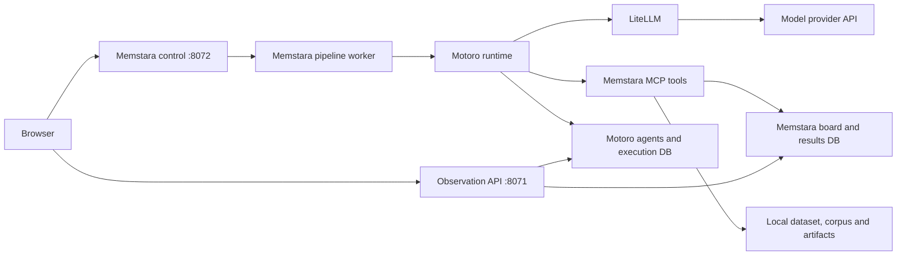

# Memstara developer guide

This guide describes the current working implementation: configuration, model routing,
execution controls, evidence storage, and debugging. Start with the installation steps
in [README.md](README.md#get-started) and the service setup in
[viewer/README.md](viewer/README.md). Run commands from the repository root with the
project's Python environment active. Examples use deployment placeholders, not usable
credentials or guaranteed model identifiers.

## Contents

- [Architecture and ownership](#architecture-and-ownership)
- [Environment and configuration precedence](#environment-and-configuration-precedence)
- [Model profiles and their limits](#model-profiles-and-their-limits)
- [Change a saved pipeline through the API](#change-a-saved-pipeline-through-the-api)
- [Configure a single combination](#configure-a-single-combination)
- [Start, pause, resume, and end](#start-pause-resume-and-end)
- [Restart after a change](#restart-after-a-change)
- [Agent contracts and skills](#agent-contracts-and-skills)
- [Read and verify an execution](#read-and-verify-an-execution)
- [Troubleshooting](#troubleshooting)
- [Development checks and source map](#development-checks-and-source-map)

## Architecture and ownership



Memstara owns research policy, skills, stage routing, data/ML tools, and the workspace.
Motoro is an imported runtime library; it provisions agents and executes their calls.
LiteLLM is used inside Motoro for provider calls and usage accounting. An API call made
directly to a provider proves connectivity only; it does not verify the pipeline path.

`PipelineLLMService` is Memstara's runtime adapter. It supplies request policies and
installs a process-local pricing compatibility adapter. This does not edit Motoro's
source or its pricing database. Unknown deployment prices remain unavailable; a zero
cost field without supported pricing must not be interpreted as free execution.

The web container normally serves port 8070. `/control/` is proxied to the host control
service, and `/api/` to the observation API. The control service can launch processes;
it is not a read-only service. Database connection setup and local access boundaries
are described in the viewer README.

## Environment and configuration precedence

[env.py](src/memstara/env.py) reads Memstara's `.env`, then the sibling Motoro `.env`.
Values already present in the process are preserved. Thus exported values win, and
when a key occurs in both files the first loaded value wins. Editing a file does not
replace values already loaded into a running process or its child environment.

| Setting | Purpose |
|---|---|
| `MEMSTARA_LLM_PROVIDER`, `MEMSTARA_LLM_MODEL` | Deployment default model selection |
| `MEMSTARA_LLM_API_BASE` | Endpoint for the deployment default provider |
| `OPENAI_API_KEY` | OpenAI-compatible provider credential |
| `ANTHROPIC_FOUNDRY_API_KEY`, `ANTHROPIC_FOUNDRY_RESOURCE` | Claude-on-Foundry credential/resource; an explicit profile `api_base` can supply the endpoint |
| `ANTHROPIC_API_KEY` | Native Anthropic credential |
| `MOTORO_DATABASE_URL` | Motoro agents and execution records |
| `MEMSTARA_DATABASE_URL` | Memstara tasks and results |
| `MEMSTARA_DATASET_PATH` | Input cohort CSV |
| `MEMSTARA_OUTCOME_COLUMN` | Target excluded from predictor discovery; keep consistent with `y_column` |
| `AGENTIC_OKF_BUNDLE_DIR` | Knowledge corpus directory |
| `MEMSTARA_OUTPUT_DIR` | Tool-generated data and model artifact root |
| `MEMSTARA_EXPLANATION_SOURCES` | Optional explicit expert-source binding JSON |

Use [.env.example](.env.example) for product settings. Keep credentials in the local
runtime environment; never put them in `stage_models`, a request JSON file, or a prompt.
`ANTHROPIC_FOUNDRY_BASE_URL` alone is not a substitute for the runtime's resource/profile
configuration: inspect the explicit profile and resolver rather than assuming that
any environment variable with a similar name is consumed.

Model selection has two paths:

1. With nonempty `configuration.stage_models`, the five agent roles receive the
   explicit profiles described below.
2. Without those profiles, new launches use `config/stage-models.local.json` when
   present, or the file explicitly selected by `MEMSTARA_STAGE_MODELS_PATH`.
   This deployment-local JSON uses the two-profile structure below and is not committed.
   An explicitly selected missing or invalid file fails validation; it never silently
   falls back. Saved nonempty profiles take precedence. Resume and report recovery
   retain their frozen profiles rather than importing new deployment defaults.
3. Without either profile source, agents use the deployment-wide model. Legacy top-level
   `provider`/`model` fields and board CLI flags do not independently override that
   deployment selection.

The control request still validates the deployment-wide model even when profiles are
present. Keep valid deployment defaults configured. Changing only
`MEMSTARA_LLM_MODEL` does not replace explicit `stage_models` profiles.

`outputs/runs/pipeline_workspace.json` stores editable pipeline definitions. The
control service also keeps them in memory: update them through its API. Per-execution
`config.json`, `prompts.json`, and `resume_arguments.json` are historical evidence,
not files to edit to change the next experiment. The run-directory root is defined
separately from `MEMSTARA_OUTPUT_DIR` in [paths.py](src/memstara/paths.py).

## Model profiles and their limits

The current implementation accepts exactly two profile keys, `non_explanation_agents` and `explanation_agent`.
These model-independent names identify two stage groups; deployment names can belong to other model families. They are not five independently configurable stage slots.

| Profile | Roles |
|---|---|
| `non_explanation_agents` | Question generation, Hypothesis, Data, ML, Interpretation |
| `explanation_agent` | Explanation, internally called `report` |

Legacy configurations with exactly `qwen`/`sonnet` or `analysis`/`explanation` are accepted and normalized
to `non_explanation_agents` and `explanation_agent`. Mixed or duplicate old/new keys are rejected.
Historical artifacts are not rewritten. Stage routing and model identities do not change.

Conceptual profile structure (replace every example endpoint/deployment):

```json
{
  "non_explanation_agents": {
    "provider": "openai",
    "model": "qwen-your-deployment",
    "api_base": "https://your-qwen-endpoint.example.com/v1",
    "max_tokens": 4096
  },
  "explanation_agent": {
    "provider": "azure_foundry",
    "model": "claude-sonnet-your-deployment",
    "api_base": "https://your-foundry-resource.example.com",
    "max_tokens": 4096
  }
}
```

`model` is the actual deployment identifier. A model catalog entry is not proof that
that identifier is deployed or supports the requested API. For Claude on Foundry,
use the `azure_foundry` provider and the resource base URL; Motoro/LiteLLM select the
Anthropic Messages route. Do not send that model to an OpenAI Chat Completions URL
merely because the resource also exposes an OpenAI-compatible endpoint.

Allowed profile fields are `provider`, `model`, `api_base`, `temperature`,
`max_tokens`, and `effort`. Endpoints must use HTTPS without embedded credentials,
query parameters, or fragments. The validator checks nonempty deployment names and basic ranges;
it does not prove a deployment supports every generation parameter. Omit unsupported
sampling controls and verify the actual provider request.

The Qwen request adapter can raise the outgoing token limit to its policy minimum and
apply reasoning settings. A profile's `max_tokens` is therefore not necessarily the
final request limit. See [runtime.py](src/memstara/pipeline/runtime.py),
[llm.py](src/memstara/pipeline/llm.py), and recorded provider diagnostics.

There is currently no dedicated per-stage model editor in the browser. Switching
Explanation to another supported model only requires editing the `explanation_agent` profile. Assigning a different model to ML alone requires changing
[stage_models.py](src/memstara/stage_models.py), its validation and routing tests, and
any configuration consumers. Renaming a profile key or editing `.env` alone is not
sufficient. Do not silently substitute a model when a deployment fails.

## Change a saved pipeline through the API

The following Python fragments use the standard library. Run them in the same Python
session, or combine them into a local script. Configuration updates do not start a run.

First read a summary without dumping endpoint or credential configuration:

```python
import copy
import json
from urllib.request import Request, urlopen

BASE = "http://127.0.0.1:8072"

def request(path, body=None):
    payload = None if body is None else json.dumps(body).encode("utf-8")
    req = Request(BASE + path, data=payload,
                  headers={"Content-Type": "application/json"})
    with urlopen(req, timeout=60) as response:
        return json.load(response)

pipelines = request("/control/pipelines")["pipelines"]
for item in pipelines:
    print(item["id"], item["name"], "running:", bool(item.get("running")))
```

Select the intended pipeline and change only the desired model fields. This example
requires an existing two-profile definition. To introduce profiles to a legacy
pipeline, assign the complete validated structure shown above instead.

```python
pipeline_id = "REPLACE_WITH_PIPELINE_ID"
item = next(p for p in pipelines if p["id"] == pipeline_id)
if item.get("running"):
    raise RuntimeError("End the execution before changing its configuration")

configuration = copy.deepcopy(item["configuration"])
profiles = configuration["stage_models"]
if set(profiles) != {"qwen", "sonnet"}:
    raise ValueError("This example requires existing Qwen/Sonnet profiles")

profiles["non_explanation_agents"]["model"] = "qwen-your-new-deployment"
profiles["explanation_agent"]["model"] = "claude-sonnet-your-new-deployment"
# Preserve provider/api_base only when the new deployment uses the same connection.
# Otherwise change those fields together and configure the matching credential.
saved = request("/control/pipelines", {
    "action": "update", "id": pipeline_id, "configuration": configuration
})
assert saved["configuration"]["stage_models"] == profiles
print("Saved configuration for", saved["id"])
```

`configuration` is a replacement object, not a recursive patch. Preserve all existing
fields unless deliberately changing them. The service rejects changes to a live
pipeline, including one with a paused process. Do not directly edit the workspace
JSON while the service is running.

## Configure a single combination

Skill identifiers come from `GET /control/playbooks`; knowledge filters come from
`GET /control/skills`. Use identifiers actually available on the deployment.
Current specialist skills require their external source files to be installed.

To set the first specialist route on the configuration obtained above:

```python
configuration.update({
    "combination_skills": {
        "hypothesis": ["addiction-psychiatric"],
        "data": ["data_training_heavy"],
        "ml": ["ml_pilot_lr_focus"],
        "interpreter": ["shared-anil-shap"],
        "report": ["shared-anil-addiction"]
    },
    "combination_repetitions": 1,
    "combination_random_start": False,
    "combination_max_loops": 1,
    "baseline_columns": [],
    "waves": 1,
    "continuous": False
})
# Keep the existing, verified y_column and evaluation settings.
saved = request("/control/pipelines", {
    "action": "update", "id": pipeline_id, "configuration": configuration
})
```

An alternative is `action: "add"` with `name` and the complete `configuration`, which
creates a separate definition and returns its `id`. The workspace has no fixed limit on saved pipeline definitions. Adding or updating a definition does not execute it.

All Combinations schedules the Cartesian product of selected skills. Normally total
Loops equal the product of skill counts times repetitions. When `combination_max_loops`
is set, it supplies the execution budget instead; the ordered/cyclic schedule may
cover only part of the combinations or repeat them. Check the saved combination plan
rather than assuming a particular total such as 64. A Loop can contain many model
calls. Random Start randomizes the schedule's starting position; it is different from
the `random_features` Hypothesis skill.

## Start, pause, resume, and end

Starting spends model and compute resources. Run only the start command matching the
intended operation. These examples use `request` and `pipeline_id` defined above.

| Operation | Request |
|---|---|
| First execution of a definition | `POST /control/runs`, body `{"pipeline_id": "..."}` |
| New execution after a previous one | Same route, with `execution_mode: "fresh"` and `expected_run_tag` |
| Request pause | `POST /control/runs/{run_tag}/pause`, body `{}` |
| Resume | `POST /control/runs/{run_tag}/resume`, body `{}` |
| End the live process | `POST /control/runs/{run_tag}/end`, body `{}` |
| Read workspace execution state | `GET /control/pipelines` |
| Read execution records | `GET /control/runs` |

For a definition that has never run:

```python
started = request("/control/runs", {"pipeline_id": pipeline_id})
run_tag = started["run_tag"]
print(run_tag, started["run_dir"])
```

For an existing definition, refresh its execution history and supply the actual last
run tag. A stale tag is rejected rather than launching against changed history:

```python
started = request("/control/runs", {
    "pipeline_id": pipeline_id,
    "execution_mode": "fresh",
    "expected_run_tag": "REPLACE_WITH_LATEST_RUN_TAG"
})
run_tag = started["run_tag"]
print(run_tag, started["run_dir"])
```

Pause is cooperative: an in-flight call may still be finishing. A pause acknowledgement
is not proof of zero active work. Use execution state and `active_calls` to distinguish
requested pause from a settled pause. Resume continues the same run when safe; it does
not reload new Python code into a live worker. Checkpoint recovery rejects changed code,
failed executions, and interrupted operations whose effects cannot be safely replayed.
Preserve the old evidence and use a fresh execution when recovery is blocked.

For CLI operation, `python -m memstara.pipeline.board --help` lists the supported
options. `--stage-models` takes a JSON object with the same two profiles. It does not
read a JSON filename automatically. CLI flags are not a replacement for the control
workspace's stored definition; choose one launch path and record it.

## Motoro release compatibility

This checkout uses Motoro `v0.10.0`. Use Python 3.12 or 3.13;
Memstara constrains Python to `<3.14` because its pinned viewer-test FastAPI and
MCP 1.29+ have conflicting Starlette requirements on later Python versions.
The MCP SDK requirement is `>=1.29.0,<2.0.0`.

A Git checkout update alone does not refresh installed version metadata. After
selecting the intended Motoro tag, reinstall its editable package in the same
Python environment that launches Memstara. Compare both the source tag and
`importlib.metadata.version("motoro")`. Back up the runtime database and apply
Motoro's official migration chain before starting a worker on the new release.
For v0.10.0 the schema head remains `6a4d9f2c7e10`; the v0.9.0-to-v0.10.0 diff
contains no migration changes. Restart existing host processes after
the update; already-imported modules do not change when a checkout changes.

Verified on 2026-10-09: editable install reports Motoro `0.10.0`; 80 focused
Memstara compatibility tests and 44 upstream model-capability tests passed.
`uv pip check` reported all 149 installed packages compatible. These are offline
checks, not live inference or full pipeline acceptance. The control service was
restarted after confirming no active execution, and its research-input API responded.
Motoro v0.10.0 changes sampling defaults for unknown models and supports explicit
resolved capabilities; validate provider-specific settings before a live run.

## Restart after a change

| Change | Required action |
|---|---|
| Saved profile/skill selection via API | End the existing execution, save, then start a fresh execution; no control restart for this alone |
| `.env`, API key, endpoint environment | Restart control from an environment without stale exported values, then launch a new worker |
| Pipeline Python implementation | Run focused checks and start a new worker; restart control too if its imported code changed |
| Observation API code | Restart/rebuild API, or use its development reload mode |
| Frontend code | Vite updates development views; Docker serving requires a web rebuild |
| Prompt or skill text | Start a new execution and verify the frozen prompt/source hash; preserve old snapshots |

For host control, stop its terminal process after managing active pipeline workers,
then start `python -m memstara.control` again. Restarting the web container alone
neither reloads the host control environment nor updates a running pipeline worker.
Starting a second control process on the same port is not a restart.

```bash
# Rebuild only the viewer services that changed.
docker compose -f viewer/docker-compose.yml up -d --build --no-deps api web
```

A successful server health check does not prove that a model deployment can respond.
Verify a small synthetic call through Memstara's `PipelineLLMService` and Motoro, then
validate the requested route end to end. A model-list response is insufficient.

## Agent contracts and skills

| Stage | Inputs and responsibilities | Evidence to inspect |
|---|---|---|
| Question/Hypothesis | Knowledge sources, question history and eligible feature context; choose a research question and predictors | Question lineage, knowledge reads, selection provenance, model/tool traces |
| Data | Exact hypothesis predictors, target and allocation skill; server validates extraction and executes the split | Extracted data identity, allocation proposal, row indices and class counts |
| ML | Frozen data allocation; LLM proposes complete LR/XGBoost settings within resource/parameter constraints | Accepted ML plan, both model results, split and prediction files |
| Interpretation | Selected SHAP or LIME skill, both fitted models' measured evidence | Two-model handoff, XAI artifacts, input/output receipts |
| Explanation | Interpretation outputs and scoped knowledge retrieval | Retrieval receipts, supplied document identities, actual model record and report |

All Combinations freezes a 4–20 original-predictor policy. `random_features` selects
within the same bounds using recorded sampling state; target columns are excluded.
For new combination runs, Guided and Random share a complete-predictor candidate
pool compatible with both LR and XGBoost. Missing-value columns are excluded before
question generation; no patient rows or values are changed or imputed. Eligibility
checks use input completeness, not outcome associations or model scores. The frozen
context records excluded columns/counts, the eligibility policy and the candidate
pool hash. Fewer than four complete predictors blocks launch before paid model calls.
The model-specific ML validator remains enabled as a final integrity check.
This changes new-run candidate eligibility; historical samples and results are not
rewritten. Standalone XGBoost retains its native missing-value support.
An extracted CSV includes the target for learning, but that target must never be in
the fitted predictor list. Use recorded model inputs to verify this distinction.

`data_training_heavy` allows an evaluation fraction of 0.1–0.3 of the exploration
population. `data_balanced_stratified` fixes it at 0.5. Both require stratification.
Here "balanced" means equal train/evaluation sizes, not class oversampling. A separate
validation reserve is removed before this allocation. Counts, indices and seeds are
saved so both learners use the same partition.

`ml_pilot_lr_focus` and `ml_pilot_xgb_focus` both fit LR and XGBoost; they differ in the
primary modeling perspective. The LLM does not have unrestricted control over compute:
server-owned parameter ranges, data splits, fit budgets, CPU/thread and memory limits
still apply. See [ml_configuration.py](src/memstara/ml_configuration.py) and
[paired_ml.py](src/memstara/paired_ml.py). Existing single-model paths and their engine
settings are separate from this paired workflow.

Matched experiments with `controlled_comparison` use a server-owned, precommitted
ML plan instead of asking the LLM to reproduce it. `get_ml_configuration` returns
`plan_source: server_frozen`; the agent should omit `ml_plan` from `train_and_score`.
The server validates and applies the frozen plan, including its rationale. A supplied
proposal cannot change it. The evaluation artifact records `ml_plan_resolution`,
including the submitted proposal, whether it was ignored, and the effective plan.
Ordinary configurable runs still require a complete LLM proposal and rationale.

The current shared specialist catalog uses exact root filenames:
`SHAP-Interpretation.md`, `LIME-Interpretation.md`, `Addiction-Expert-Explanation.md`,
and `HIV-Expert-Explanation.md`. Resolution is defined by
[catalog.py](src/memstara/control/catalog.py); archived files are not fallback sources.
Deployments need authorized current copies, and runs freeze their contents/hashes.
Each Interpretation specialist receives both models; choosing SHAP for a single route
does not also execute LIME. Inspect the recorded explanation sample size: bounded XAI
samples are not automatically summaries of the entire evaluation cohort.

Without an explicit `MEMSTARA_EXPLANATION_SOURCES` binding, current expert Explanation
uses provisional metadata-keyword scopes over the configured OKF corpus. Scopes may
overlap, and the policy records that confirmation is still required. These are not
separate approved clinical databases. Explicit SQLite/PostgreSQL bindings use
[explanation-sources.example.json](config/explanation-sources.example.json).
Do not invent corpus taxonomy filters for a clinical domain: query available filters.
Missing scoped evidence fails explicitly instead of falling back to unrelated sources.

## Read and verify an execution

Use the `run_dir` returned by start; do not select a folder solely by its modification
time. Store execution identifiers alongside comparisons so another route's results
cannot be mistaken for this one. Paths below are relative to that run directory unless
stated otherwise.

| Artifact | What it establishes |
|---|---|
| `config.json`, `prompts.json` | Frozen policies, profiles, skills, prompt contents and identifiers |
| `loop_1_flavors.json` and subsequent Loop files | The scheduled condition for each Loop |
| `execution.json`, `calls_checkpoint.json` | Agent run IDs, stage status and timing |
| `trace/*.txt`, `trace/*.llm.txt` | Saved stage/tool traces and captured model request evidence |
| `provider_diagnostics.jsonl` | Response finish reasons, token limits, tool-call argument shape |
| `model_retries.jsonl` | Retry events, when retries occur |
| `feature_reproduction/` | Local input/corpus archive, selection policy and accepted extraction receipts |
| `board.json` | Final task/result snapshot, including model evidence references |
| Referenced reproducibility bundles | Fitted models, split indices, probabilities, labels, effective settings and manifests |
| Referenced Interpretation receipts | Exact handoff and saved interpretation output |
| `explanation_io/` | Scoped retrieval/input/output/model records and per-Loop report receipts |
| `report.md`, `report_status.json` | Final report and its acceptance status |
| `pipeline_status.json`, `iteration_outcomes.json` | Overall/Loop outcomes, missing trials and unfinished tasks |
| `pipeline_failure.json`, `failure_frames.json` | Failure category and relevant frames when present |
| `checkpoint.json`, `execution_control.json` | Recovery bookkeeping and active-call state |

Some files exist only after the corresponding stage, or only on failure. Model/XAI
bundles and Interpretation receipts can live outside `run_dir` under the configured
artifact root; follow their recorded paths. Copying only `report.md` or the run folder
does not necessarily preserve a complete replay bundle. These artifacts can contain
sensitive data and prompts; they are not public documentation examples.

A rigorous one-route acceptance check includes all of the following:

1. Control shows no remaining live worker; pipeline/report/Loop status is completed,
   the checkpoint is finished, and no failed calls or unfinished tasks remain.
2. Actual trace models match the frozen profiles, including Explanation's `report`
   stage. A saved setting alone is not proof of the model used.
3. Predictor selection is within bounds; extraction preserves row order and values;
   the fitted model excludes the target.
4. Train, evaluation and reserved rows are disjoint; both models share the same
   partitions. Confirm the scope of each reported confusion matrix.
5. Recompute metrics from saved labels and probabilities. Distinguish trapezoidal
   PR-AUC from average precision. Verify threshold selection and undefined metrics.
6. Verify artifact hashes and model/XAI/task/split identities, both-model access by
   Interpretation, and the Explanation input/output receipts.
7. Confirm the final report matches the accepted saved output and cites supplied
   evidence. Citation identity checks do not establish clinical truth or relevance.

`reserved_not_evaluated` means precisely that the independent reserve has no final
validation score. A confusion matrix on the exploration evaluation split is not the
reserve's confusion matrix, even when both happen to have the same number of rows.
Do not describe a successful pipeline run as completed independent validation.

Replay utilities:

```bash
# Offline feature-selection integrity/replay; does not regenerate LLM text.
python -m memstara.feature_reproduction /path/to/feature_reproduction

# Retrains ML from the saved bundle: additional local compute, no new LLM generation.
python -m memstara.reproducibility /path/to/model_bundle

# Recomputes supported XAI against saved models: additional local compute.
python -m memstara.specialist_xai /path/to/model_bundle
```

Use only trusted local bundles. Read the utility's output for environment/hash
compatibility and limits. One route proves neither all skill combinations nor
statistical robustness, clinical utility, or identical future LLM generation.

## Troubleshooting

Environment diagnostics accept the selected input modes. For a proposal without
an OKF corpus or CSV, use:

```sh
python -m memstara.preflight --quick --knowledge-mode llm_only --data-mode proposal
```

Omit a mode flag to retain its default (`okf` or `dataset`). Unselected source
paths are not inspected, and proposal mode skips the dataset matcher. Missing
optional `.env` files are informational when settings are exported. Database and
credential checks still apply. This environment diagnostic does not certify input
quality, selected skill compatibility or a successful inference; execution performs
its own preflight. Tests and their evidence boundaries are described in
[tests/README.md](tests/README.md).


| Symptom | Checks and next action |
|---|---|
| `DeploymentNotFound` | Compare the actual deployment identifier and endpoint. A catalog display name can differ. Do not silently change model families. |
| `api_not_supported` | Check provider protocol and base URL; Claude Foundry may need Messages rather than OpenAI Chat Completions. |
| HTTP 500/502/503/504/529 | The model-request adapter retries up to five times (six attempts total), with delays of 2, 4, 8, 16 and 32 seconds. It resends the same request without replaying agent tools. Inspect `model_retries.jsonl` and bounded HTTP/correlation metadata; persistent failure stops later work. A retry does not guarantee provider recovery. |
| Authentication failure | Check the selected provider's credential in the new worker's environment; do not print secrets. |
| Old model still used | Check explicit profiles, stale parent environment, frozen config, and actual agent traces. |
| Missing tool or empty tool list | Check Memstara tool registration/grants, child-process environment and stderr; do not edit Motoro to bypass grants. |
| Pricing unavailable | No supported rate exists for that identifier. Preserve tokens and unknown-cost status; never fabricate a rate or call it zero cost. |
| `completion_cost` rejects token arguments | Check that the Memstara pricing adapter is installed by `PipelineLLMService`; the token fallback uses `cost_per_token`. |
| Explanation citation rejected | Compare every individual reference with the frozen retrieved documents. Semicolon-grouped references are checked individually; unknown documents still fail. |
| Needs attention / failed | Read `pipeline_failure.json`, the failing call trace and report status. A completed LLM response can still fail downstream validation. |
| Pause still looks active | Inspect active calls and process state; a request acknowledgement is not a settled pause. |
| Resume blocked | Preserve original records; review changed code or interrupted effects, then start a fresh execution when appropriate. |
| Display error while worker runs | Check web/API separately from control. A rendering failure is not evidence that the worker stopped. |
| Strong-looking accuracy but few positives detected | Inspect confusion counts, prevalence, PR metrics and the chosen threshold; do not equate execution success with predictive quality. |

When diagnosing logs, extract stage identifiers, error categories and aggregate
metrics first. Raw debug log messages may contain complete model requests or data;
never paste an entire request log into an issue. Keep recovered artifacts separate
from the original failure record and distinguish offline response revalidation from
a fresh uninterrupted execution.

## Development checks and source map

Run focused tests before a live verification. Example checks for this configuration:

```bash
python -m pytest -c /dev/null -p no:cacheprovider -q \
  tests/test_pricing_compat.py tests/test_pilot_model_provisioning.py \
  tests/test_control_request.py tests/test_pipeline_workspace.py \
  tests/test_specialist_explanation.py
python -m ruff check src/
npm --prefix viewer/web run typecheck
npm --prefix viewer/web test
```

The specialist integration test includes real synthetic ML and resource supervision;
a restricted process-inspection sandbox may prevent it from running. A permission
failure is not a passed test, and replacing it with a mock does not validate that
resource boundary. Browser tests/build steps are described in the viewer README and
its package scripts. Use the repository's isolated test environment for the broader
checks listed in the main README.

| Source | Responsibility |
|---|---|
| [control/request.py](src/memstara/control/request.py) | API fields and conversion to board CLI arguments |
| [control/workspace.py](src/memstara/control/workspace.py) | Saved definitions, limits and mutation rules |
| [control/service.py](src/memstara/control/service.py) | HTTP routes, launch and execution lifecycle |
| [stage_models.py](src/memstara/stage_models.py) | Two-profile validation and role assignment |
| [pipeline/core.py](src/memstara/pipeline/core.py) | Agent provisioning, settings refresh and runtime integration |
| [pipeline/llm.py](src/memstara/pipeline/llm.py) | Motoro LLM adapter, request and retry policies |
| [pricing_compat.py](src/memstara/pricing_compat.py) | Process-local cost API compatibility |
| [pipeline/snapshot.py](src/memstara/pipeline/snapshot.py) | Frozen run configuration |
| [combinations.py](src/memstara/combinations.py) | Schedule construction and per-Loop choices |
| [data_allocation.py](src/memstara/data_allocation.py) | Agent-proposed, server-validated data partition |
| [specialist_xai.py](src/memstara/specialist_xai.py) | SHAP/LIME evidence, identity checks and receipts |
| [specialist_explanation.py](src/memstara/specialist_explanation.py) | Scoped expert handoff, citation acceptance and report assembly |
| [okf_expert.py](src/memstara/okf_expert.py) | Provisional corpus scopes |
| [pipeline/checkpoint.py](src/memstara/pipeline/checkpoint.py) | Safe recovery restrictions |

For interactive code exploration, open `/developer.html` on the viewer origin and
follow the [Code Atlas guide](viewer/web/src/developer/README.md). Its inventory is a
generated snapshot and must be rebuilt after source changes; it is not a live view of
the filesystem. Keep this guide and API examples synchronized when changing routing
keys, execution semantics, source bindings, or artifact formats.

## Cost evidence and Azure API integration

The Totals view includes **Cost details and Azure reconciliation** for the selected
execution. It separates recorded token-based estimates from Azure-reported cost for
a subscription/resource-group period. These two numbers must never be added together
or presented as identical scopes. Azure reported actual cost can be delayed and is
not a final invoice or an agent-level attribution.

New pipeline requests write `cost_ledger.jsonl` in their run directory. Records include
agent invocation, stage, loop, requested/response model, normalized input/output/cache
token counts, estimated USD, source, and a frozen price receipt when an explicit
catalog was used. Failed requests without usage remain unpriced: they may still be
billed. Internal provider retries not exposed by the runtime cannot be reconstructed
from a single aggregate response. Historical runs without receipts remain historical;
no current price is silently applied to old calls. The UI supports a JSON evidence
download and shows priced/recorded attempt coverage and partial subtotals.

### Retrieve public Azure token rates

No login is needed for the public Retail Prices API. Discover candidate meters:

```sh
.venv/bin/python -m memstara.azure_costs meters \
  --filter "contains(productName, 'OpenAI') and contains(meterName, '4o')" \
  --output outputs/pricing/azure-gpt4o-meters.json
```

Compare actual deployment model/version, deployment type and resource region with
these items. Never choose a meter from a substring alone: realtime, audio, batch,
regional and global products can all contain the same model name. Copy
`config/azure-pricing-meters.example.json` to the ignored
`config/azure-pricing-meters.local.json` and fill exact identifiers. Remove cache_read
only if no corresponding meter is available; cached requests then remain unpriced.
Do not map a Marketplace model to an unrelated Azure OpenAI meter.

```sh
.venv/bin/python -m memstara.azure_costs refresh \
  --mapping config/azure-pricing-meters.local.json
```

Refresh downloads exact meter records with pagination, validates USD/Consumption,
region, effective date, tier and token units, and writes the catalog atomically only
when every profile succeeds. `1K` prices are multiplied by 1,000 to obtain USD per
million tokens. Hourly compute and ambiguous matches are rejected. Prices are valid
for new estimates for seven days; run this refresh again before they expire. No
network request runs in the inference path, and this command does not change Azure.
The source records and refresh dates remain in the local catalog.

`MEMSTARA_PRICING_PATH` optionally overrides `config/pricing.local.json`. Explicit
catalog entries match **provider, deployment name and endpoint** exactly. Normalized
cached input is subtracted from input before applying the cached rate; it is never
charged twice. Aggregate cache-write counts do not identify TTL, so the explicit
calculator leaves those calls unresolved rather than guessing between 5-minute and
1-hour rates. Runtime/library estimates may still be available and are labeled as
such, not as verified Azure prices. Existing two-rate overrides are not applied to
cached responses. Unknown/expired catalog entries do not become zero-dollar calls.

Claude/Marketplace rates may not be available through this retail endpoint. A reviewed
contract/provider rate entry can be supplied in the local catalog with the same profile
identity, `billing: "tokens"`, `currency: "USD"`, `source`, `retrieved_at`, timezone-aware
`valid_from`/`valid_until`, and `usd_per_million_tokens` keys `input`, `output`, and
`cache_read`. Only use verified rates for that deployment and date. Retail rates do
not include negotiated discounts, taxes, or non-token infrastructure charges.

### Retrieve Azure account costs

Install Azure CLI and sign in with a Cost Management reader at the selected scope.
The inference API key cannot authorize billing access. Do not put login tokens in
model configuration or expose them to the frontend.

```sh
az login --use-device-code
.venv/bin/python -m memstara.azure_costs actual \
  --scope /subscriptions/YOUR_SUBSCRIPTION_ID/resourceGroups/YOUR_RESOURCE_GROUP \
  --start 2026-10-07T00:00:00Z --end 2026-10-08T00:00:00Z
```

Actual expenditure must come from Azure billing evidence in both UI and reports.
Always show retrieval time, reporting period, currency, and scope. Missing billing
rows are pending/unavailable, never zero. Do not substitute token estimates or an
allocated share of aggregate charges for an exact execution charge. Current-period
ActualCost is not a finalized invoice. Claude CCU aggregates cannot be attributed
to a specific execution without additional billing evidence. Estimates, if shown,
must remain separately labeled and secondary.

This read-only Cost Management Query API request aggregates daily actual cost by
service, retains currencies separately, follows pagination and saves
`outputs/runs/azure_costs.json`. The viewer already mounts that directory read-only;
`/api/azure-costs` exposes a scope/period summary, not credentials. A failed query
preserves the last successful snapshot and never writes a fake zero. Empty rows may
mean reporting delay. The UI always shows retrieval time and scope; no automatic
allocation to an individual experiment is implied. Refresh explicitly when needed;
there is no background Azure synchronization scheduler.

The request ledger is available via `/api/cost-details?run_tag=...`. The API resolves
only indexed runs and cannot read arbitrary user-supplied paths. Cost totals prefer
ledger receipts when available and remain partial when any attempt is unpriced.
Restart the viewer API/web after code changes. New pipeline workers load the pricing
adapter; no Motoro source or database schema changes are needed.

API references: [Azure retail prices](https://learn.microsoft.com/en-us/rest/api/cost-management/retail-prices/azure-retail-prices),
[Cost Management Query](https://learn.microsoft.com/en-us/rest/api/cost-management/query/usage?view=rest-cost-management-2025-03-01),
[Claude billing](https://learn.microsoft.com/en-us/azure/foundry/foundry-models/concepts/claude-models-billing).

## Experiment registry

Memstara owns the `memstara_experiments`, `memstara_experiment_combinations`,
`memstara_executions`, `memstara_execution_agents`, `memstara_execution_costs`, and
`memstara_execution_artifacts` tables. Motoro's tables are read, never modified by
this registry. Existing question, task and result tables remain authoritative for
scientific results and are joined by `run_tag`.

New board executions register their frozen configuration before agent execution,
synchronize after each agent call, and reconcile at termination. Agent records retain
recorded start times, duration, original Motoro run IDs, inputs/outputs and steps.
Request receipts preserve price evidence and unknown costs; unknown is not zero.
The final report and prompt snapshots are stored in the database. Large artifacts
remain under outputs, indexed by absolute path, byte count and SHA-256. Keep a backup
of both the Memstara database and outputs; the registry does not replace artifact storage.
The latest registry synchronization is shown in `registry_status.json`; pending means
reconciliation is required before launching further batch work. During a DB outage,
existing execution files are retained as a recovery journal, not discarded.

Reconcile an existing run without making any LLM calls:

```bash
.venv/bin/python -m memstara.experiment_registry --run-dir outputs/runs/<run-directory>
```

This does not change historical traces. Repeating it does not duplicate calls or costs.
Conflicting frozen configurations and cost receipts are rejected. Historical records
are imported explicitly; the system does not silently scan every previous experiment.
Standalone runs receive `standalone:<run_tag>` and combination `C01`.

To register a batch, provide a JSON file with `id`, `definition` (including
`planned_runs`) and `combinations`, an object keyed by `C01`, `C02`, etc. Its length
must equal `planned_runs`. Register it with `--register <file>`. Before starting a
board execution in a preallocated run directory, write `experiment_binding.json`
there with `experiment_id` and `combination_id`. Both must already exist in the DB.
Unregistered bindings and changes to an existing experiment design are rejected.
Registering a plan does not start any execution or spend model tokens.

The local viewer exposes **Telemetry → Experiments** and read-only endpoints:
`/api/experiments`, `/api/experiments/combinations?experiment_id=...`, and
`/api/experiments/execution?run_tag=...`. They query the registry without scanning
run folders. The evidence JSON includes configuration, prompts, agent records,
results, cost receipts and artifact locations. Costs remain public-price token
estimates, not Azure invoice allocations. Exploratory evaluation metrics are labeled
separately from any reserved validation evaluation.

## Research input preparation (issue #166)

The local **Floor plan → Prepare research inputs** screen can inspect and
register an analysis CSV, an OKF bundle folder and a user-defined binary target.
Paths refer to the server's local filesystem; this is not browser file upload or
remote file fetching. The source CSV and original knowledge/skill files remain
unchanged. Current CSV inspection is limited to 100 MiB and returns schema and
aggregate diagnostics, never dataset rows.

The control API exposes:

- `GET /control/research-inputs`: list saved preparation records.
- `POST /control/research-inputs/inspect`: inspect without saving a record.
- `POST /control/research-inputs/register`: inspect and save a new immutable record.

POST bodies contain `name`, `dataset_path`, `knowledge_path`, `target`,
`excluded_columns` and `missing_policy`. The target object accepts `column`,
`description`, `positive_label`, `negative_label`, `prediction_time` and optional
`horizon`; all are strings. Missing target definitions produce actionable issues.
`excluded_columns` is a list of exact column names. Only `missing_policy: "reject"`
is currently supported: inspection does not impute values or delete rows.

Records are saved under `outputs/research_inputs/` unless
`MEMSTARA_RESEARCH_INPUTS_DIR` is explicitly configured. Each record retains the
source hashes, target definition, exclusions, inspection timestamp and diagnostics.
Loading a saved record into the screen requires inspection again to validate the
current files. These records are local and must not be published as public examples.

Saving does not start an experiment or change an existing pipeline. Select the
saved version in pipeline creation (including All Combinations), or in an existing
pipeline's **Data & target** settings. The request field is `research_input_id`;
the CLI equivalent is `--research-input-id`. The record's target overrides stale
browser target settings. `input_checks_passed` is an input inspection result;
`execution_ready` stays false because registration does not verify deployment,
model connectivity, evaluation feasibility or clinical skill compatibility.

Launch rechecks the registered hashes and creates an isolated analysis copy under
`outputs/research_inputs/prepared/<fingerprint>/`. Only explicit exclusions and
the user-provided binary label mapping are applied. The child process sets its own
dataset, corpus, output and matcher-rule paths; it never changes the control
server's environment. Matcher artifacts are built before inference and reused only
with matching configuration and integrity stamps. The original cohort cache is
not overwritten. Uploaded skills remain available from their original catalog.

Each run freezes `research_profile` in `config.json` (also included in the existing
experiment registry configuration). Every agent invocation receives the target
description, label meanings, timing and horizon. Resume verifies the frozen copies
instead of following edited source files. A new execution requires a newly saved
version if sources changed. Run-scoped question-bank reads retain their existing
isolation. Do not edit generated research files.

Generic profiles accept `hypothesis_research`, `random_features` or reviewed custom
Hypothesis skills. Legacy corpus-specific Hypothesis defaults and unbound
Addiction/HIV Explanation specialists are rejected rather than silently reused.
Anil/Phil originals are not modified. Review other custom skills for compatibility.

See [the synthetic walkthrough](examples/research-inputs/README.md) for a complete
input example and commands. It contains generated numbers and invented educational
knowledge, not patient data or clinical evidence. HeartFailure originals are not
part of the public example. A paid run and clinical target validation are separate
from the offline input/dispatch/cache tests.
